# 前言

訓練一個神經網路，說穿了只做一件事：把損失函數一步一步降下來。每一步往哪裡走、走多遠，
由梯度決定。本書回答兩個問題：

1. **梯度下降怎麼走**：有了梯度之後，參數要怎麼更新，走到哪裡會停下來。
2. **梯度怎麼算**：參數有上萬個的時候，梯度要怎麼讓電腦自己算出來，而且算得又快又對。

第一個問題在第 1 章回答。第二個問題有兩種算法：數值微分簡單但很慢，倒傳遞演算法很快但容易寫錯。
第 2 章到第 6 章分別講這兩種算法，第 7 章再用第一種去驗第二種，這個動作叫梯度確認，是本書的驗收條件。

本書從頭到尾只用一個主要的示範函數：

$$L(w) = (w-3)^2$$

起點 $w = 0$，學習率 $\eta = 0.1$。最小值在 $w = 3$，一眼就看得出來。
**示範題一定要選手算得出答案的，否則程式算錯了不會知道。**

## 怎麼讀本書

| 章 | 內容 | 要動手的地方 |
|---|---|---|
| 1 | 梯度下降：更新式、學習率、停下來的地方 | 1.3 節手算表 |
| 2 | 數值微分：用導數的定義算梯度，以及它的代價 | — |
| 3 | 計算圖：把一串運算畫成節點與箭頭 | — |
| 4 | 鏈式法則與兩條節點規則 | — |
| 5 | 手算練習 | 三張表 |
| 6 | 程式：手寫版與框架版 | Colab 上跑一次 |
| 7 | 梯度確認 | Colab 上跑一次 |
| 8 | AI 時代，人在這裡做什麼 | — |
| 9 | 練習 | 六題 |

先讀第 1 到 4 章，做第 5 章的手算練習；再到 Colab 跑第 6、7 章的程式，確認跑出來的數字和自己填的一樣。
全部做完大約 2 小時。

## 術語對照

| 中文 | 英文 | 本書用的符號或縮寫 |
|---|---|---|
| 損失函數 | loss function | $L$ |
| 參數 | parameter | $w$、$\theta$ |
| 學習率 | learning rate | $\eta$ |
| 梯度 | gradient | $\nabla L$ |
| 梯度下降法 | gradient descent | GD |
| 數值微分 | numerical differentiation | — |
| 前向差分、中心差分 | forward difference、central difference | — |
| 捨入誤差 | rounding error | — |
| 計算圖 | computational graph | — |
| 正向傳播 | forward propagation | — |
| 倒傳遞演算法 | backpropagation | BP |
| 局部導數 | local derivative | — |
| 鏈式法則 | chain rule | — |
| 梯度確認 | gradient check | — |
| 極小值、最小值 | local minimum、global minimum | — |
| 鞍點 | saddle point | — |
| 學習高原 | plateau | — |
| 交叉熵 | cross entropy | — |

---

# 第 1 章　梯度下降：沿著下坡走

## 1.1 損失函數與參數

模型裡要學的數字叫參數。拿一組參數去預測，和正確答案比較，差多少用一個數字表示，
這個數字就是損失函數的值：越小代表模型越準。訓練的目標，就是找到讓損失最小的那組參數。

本書第 1 章到第 6 章只用一個參數 $w$，損失函數是

$$L(w) = (w-3)^2$$

$w = 3$ 時損失為 0，這就是答案。真實的模型看不出答案在哪裡，所以要一步一步找。

## 1.2 導數：輸入動一點，輸出動多少

導數描述的是「$w$ 動一點點，$L$ 跟著動多少」：

$$\frac{dL}{dw} = \lim_{h \to 0} \frac{L(w+h) - L(w)}{h}$$

對 $L(w) = (w-3)^2$ 推導，得到

$$\frac{dL}{dw} = 2(w-3)$$

在 $w = 0$，導數是 $2(0-3) = -6$：$w$ 增加一點點，$L$ 會減少大約 6 倍那麼多。
導數是負的，表示往右走是下坡。

## 1.3 更新式

梯度下降法 gradient descent（GD）每一步都做同一件事：

$$w^{(k+1)} = w^{(k)} - \eta\,\frac{dL}{dw}\bigg|_{w = w^{(k)}}$$

| 符號 | 意思 |
|---|---|
| $w^{(k)}$ | 第 $k$ 步的參數 |
| $\eta$ | 學習率，一步走多遠 |
| $dL/dw$ | 梯度，參數只有一個時就是導數 |

那個**減號**是重點。梯度指的是上坡方向，我們要往下坡走，所以減掉。

以起點 $w^{(0)} = 0$、$\eta = 0.1$ 為例：

$$w^{(1)} = 0 - 0.1 \times (-6) = 0.6$$

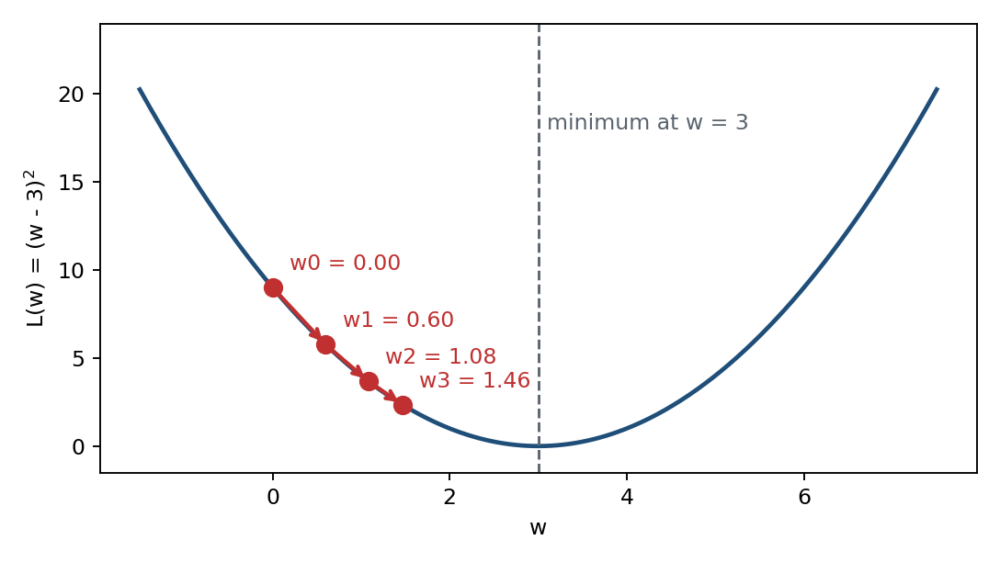

**手算練習**：把下表填完。每一列都是同三個動作：算梯度、乘學習率、減掉。

| $k$ | $w^{(k)}$ | $dL/dw = 2(w-3)$ | $\eta \times$ 梯度 | $w^{(k+1)}$ | $L(w^{(k)})$ |
|---|---|---|---|---|---|
| 0 | 0.000000 | −6.000000 | −0.600000 | 0.600000 | 9.000000 |
| 1 | 0.600000 | | | | |
| 2 | | | | | |
| 3 | | | | | |
| 4 | | | | | |
| 5 | | | | | |
| 6 | | — | — | — | |

填完之後對答案：

| $k$ | $w^{(k)}$ | $dL/dw$ | $L(w^{(k)})$ |
|---|---|---|---|
| 0 | 0.000000 | −6.000000 | 9.000000 |
| 1 | 0.600000 | −4.800000 | 5.760000 |
| 2 | 1.080000 | −3.840000 | 3.686400 |
| 3 | 1.464000 | −3.072000 | 2.359296 |
| 4 | 1.771200 | −2.457600 | 1.509949 |
| 5 | 2.016960 | −1.966080 | 0.966368 |
| 6 | 2.213568 | −1.572864 | 0.618475 |

六步還沒走到 3，因為梯度下降是逐步逼近。這個例子可以直接解出每一步：

$$w^{(k)} = 3 - 3\,(1-2\eta)^{k}$$

$\eta = 0.1$ 時 $1 - 2\eta = 0.8$，每一步離終點的距離都只剩上一步的八成。
自己驗一次：$k = 3$ 時 $3 - 3 \times 0.8^3 = 3 - 1.536 = 1.464$，和表上一樣。

**這張表的梯度欄是手推 $2(w-3)$ 之後代數字算出來的。** 參數只有一個時推得動；
參數上萬個時推不動。第 2 章開始處理的就是這件事。

## 1.4 學習率

同一個起點，三種學習率各走五步：

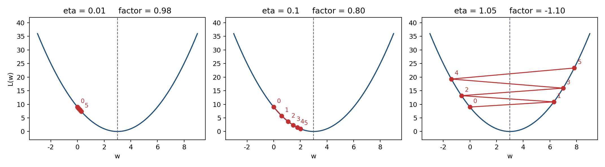

| $k$ | $\eta = 0.01$ | $\eta = 0.1$ | $\eta = 1.05$ |
|---|---|---|---|
| 0 | 0.0000 | 0.0000 | 0.0000 |
| 1 | 0.0600 | 0.6000 | 6.3000 |
| 2 | 0.1188 | 1.0800 | −0.6300 |
| 3 | 0.1764 | 1.4640 | 6.9930 |
| 4 | 0.2329 | 1.7712 | −1.3923 |
| 5 | 0.2882 | 2.0170 | 7.8315 |

每一步離終點的距離乘上 $1 - 2\eta$：

| $\eta$ | $1-2\eta$ | 結果 |
|---|---|---|
| 0.01 | 0.98 | 每步只縮 2%，五步後還在 0.29，走不動 |
| 0.1 | 0.80 | 穩定收斂 |
| 1.05 | −1.10 | 絕對值大於 1，每步放大並換邊，發散 |

判準：$|\,1-2\eta\,| < 1$，也就是 $0 < \eta < 1$。

## 1.5 兩個以上的參數：梯度是一個向量

參數不只一個時，對每個參數各自求導數，排成一個向量，就是梯度：

$$\nabla L = \left(\frac{\partial L}{\partial \theta_1},\ \frac{\partial L}{\partial \theta_2},\ \dots\right)$$

$\partial$ 讀作「偏微分」：對其中一個參數求導數時，其他參數當成常數。以兩個參數的
$f(x_0, x_1) = x_0^2 + x_1^2$ 為例，$\nabla f = (2x_0,\ 2x_1)$：

| 位置 $(x_0, x_1)$ | 梯度 $\nabla f$ |
|---|---|
| (3, 4) | (6, 8) |
| (0, 2) | (0, 4) |
| (3, 0) | (6, 0) |

梯度指向函數值增加最快的方向，所以更新時沿著它的反方向走，每個參數各減各的：

$$\theta^{(k+1)} = \theta^{(k)} - \eta\,\nabla L(\theta^{(k)})$$

## 1.6 梯度為 0 的地方不一定是最小值

梯度下降在梯度變成 0 時就停了。但梯度為 0 的地方有好幾種：

| 名稱 | 意思 | 梯度 |
|---|---|---|
| 最小值 global minimum | 整個函數最小的地方，要找的答案 | 0 |
| 極小值 local minimum | 只在附近一個範圍內最小 | 0 |
| 鞍點 saddle point | 從某個方向看是谷底，從另一個方向看是山頂 | 0 |
| 學習高原 plateau | 一大片幾乎平坦的區域，梯度很小，學習停滯 | 幾乎 0 |

梯度下降只看梯度是不是 0，分不出這四種。以下用兩個本書設計的例子各示範一次。

**極小值。** $L(w) = \dfrac{w^4}{4} - \dfrac{w^3}{3} - w^2$，導數 $L'(w) = w(w+1)(w-2)$，
三個梯度為 0 的點在 $w = -1$、$0$、$2$：

| $w$ | $L'(w)$ | $L(w)$ | 種類 |
|---|---|---|---|
| −1 | 0 | −0.4167 | 極小值 |
| 0 | 0 | 0 | 極大值 |
| 2 | 0 | −2.6667 | 最小值 |

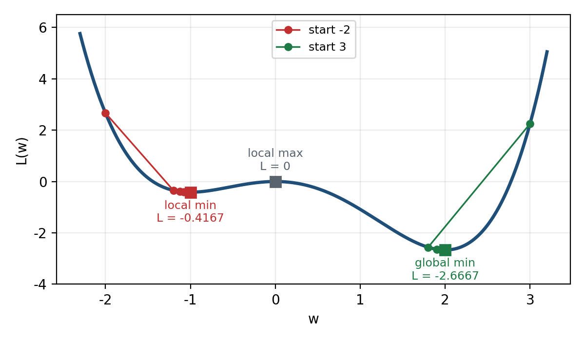

學習率 0.1，從 −2 出發依序是 −2 → −1.2 → −1.1232 → −1.079982 → …，停在極小值 −1；
從 3 出發依序是 3 → 1.8 → 1.9008 → 1.955497 → …，停在最小值 2。
兩邊的梯度最後都是 0，程式都判定收斂，但只有一邊找到最小值。
站在 $w = -1$ 往左右看都是上坡，只看附近分不出它是不是最小值；要知道有沒有更深的谷，
只能換幾個起點多跑幾次，比較停下來的損失。

**鞍點。** 曲面 $f(x, y) = x^2 + (y^2 - 1)^2$ 的鞍點在 $(0, 0)$，$f = 1$；最小值在 $(0, 1)$ 與 $(0, -1)$，$f = 0$。
在 $(0, 0)$ 沿 $x$ 方向切開是谷底，沿 $y$ 方向切開是山頂：

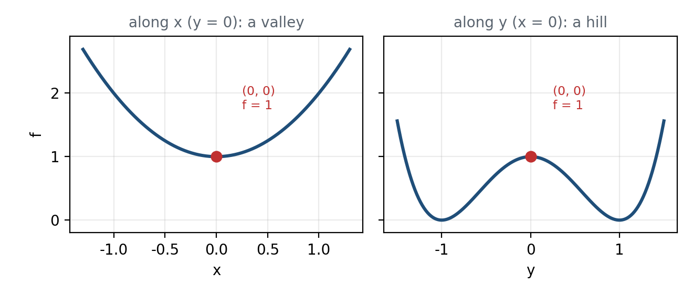

從 $(2, 0)$ 出發，$y$ 方向的梯度 $4y(y^2-1)$ 永遠是 0，$y$ 一步都不動。第 30 步時 $x = 0.002476$，
$f = 1.000006$，梯度大小只剩 $4.95 \times 10^{-3}$，看起來收斂了，其實停在鞍點。
往四個方向各動 0.1 就看得出來：$(\pm 0.1, 0)$ 的 $f$ 是 1.01，比 1 高；
$(0, \pm 0.1)$ 的 $f$ 是 0.9801，比 1 低。**只要有一個方向的損失會下降，那一點就不是極小值。**

**學習高原。** 起點稍微偏離中線，例如 $(2, 0.001)$，梯度下降最後會滑到最小值，
但要先在鞍點附近耗很久：

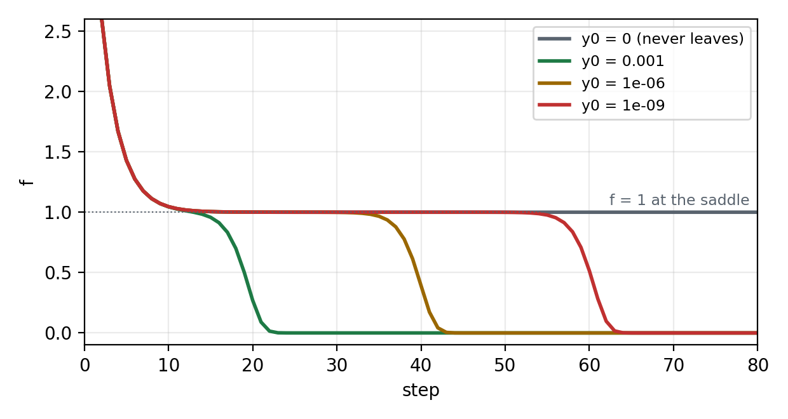

| 起點的 $y$ | 損失第一次低於 0.5 |
|---|---|
| 0 | 不會發生 |
| 0.001 | 第 20 步 |
| 0.000001 | 第 40 步 |
| 0.000000001 | 第 61 步 |

平的那一段就是學習高原。那段期間梯度接近 0、損失幾乎不變，外觀和真的收斂一模一樣；
太早停止訓練，就會誤以為損失 1 已經是最好的結果。

本章的結論只有一句：**「梯度變成 0」是程式停下來的理由，不是答案正確的證明。**

---

# 第 2 章　數值微分：讓電腦自己算梯度

第 1 章的梯度是人推出來的。本章介紹第一種讓電腦自己算的方法：數值微分 numerical differentiation。
它只用導數的定義，不必推任何公式，只要會算 $L$ 就能算梯度。

## 2.1 照定義直接寫，會出兩個問題

把 1.2 節的定義直接寫成程式：

```python
def numerical_diff_bad(f, x):
    h = 1e-50                      # 想讓 h 盡量接近 0
    return (f(x + h) - f(x)) / h
```

拿 $L(w) = (w-3)^2$ 在 $w = 0$ 試，答案應該是 −6，這支程式算出來是 **0.0**。原因有兩個。

**問題一：$h$ 太小，被捨入吃掉了。** 電腦存小數只有有限的位數。$10^{-50} - 3$ 存起來還是 $-3$，
所以 $L(0 + h)$ 和 $L(0)$ 完全相等，相減得 0。換成單精度浮點數更明顯：`np.float32(1e-50)` 直接就是 `0.0`。
這種誤差叫捨入誤差 rounding error。解法是把 $h$ 放大到 $10^{-4}$，小到夠接近 0，又大到不會被捨入吃掉。

**問題二：只取右邊一點，本身就有誤差。** 上面的寫法算的是 $w$ 與 $w + h$ 兩點連線的斜率，叫前向差分。
就算電腦算得完全精確，對 $L(w) = (w-3)^2$ 也有

$$\frac{L(w+h) - L(w)}{h} = 2(w-3) + h$$

多出來的 $h$ 就是誤差。$h = 10^{-4}$ 時在 $w = 0$ 得到 −5.9999，差了 $10^{-4}$。

## 2.2 中心差分

改成取 $w$ 左右各一點，算 $w - h$ 與 $w + h$ 兩點連線的斜率，叫中心差分：

$$\frac{dL}{dw} \simeq \frac{L(w+h) - L(w-h)}{2h} \qquad h = 10^{-4}$$

```python
def numerical_diff(f, x, h=1e-4):
    return (f(x + h) - f(x - h)) / (2 * h)
```

在 $w = 0$ 拆開算一次：

| 步驟 | 值 |
|---|---|
| $L(0 + h)$ | 8.999400010000 |
| $L(0 - h)$ | 9.000600010000 |
| 分子：兩者相減 | −0.001200000000 |
| 分母：$2h$ | 0.000200000000 |
| **中心差分** | **−6.000000000013** |
| 真正的導數 $2(0-3)$ | −6 |

和真正的 −6 只差浮點數的捨入。對二次函數，中心差分沒有問題二那個 $h$。

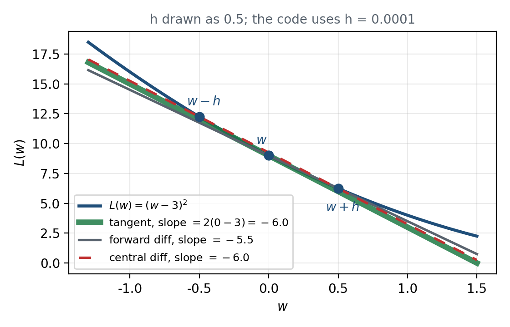

圖上紅虛線整條疊在綠色切線上，看起來像畫錯，其實是對的：二次函數的中心差分剛好精確。

## 2.3 很多個參數：一次動一個

參數有很多個時，就一個一個來：動第 1 個參數、其他不動，算一次中心差分；再動第 2 個，依此類推。

```python
def numerical_gradient(f, x, h=1e-4):
    grad = np.zeros_like(x)
    for i in range(x.size):
        keep = x[i]
        x[i] = keep + h
        fp = f(x)                  # 正向算第 1 次
        x[i] = keep - h
        fm = f(x)                  # 正向算第 2 次
        grad[i] = (fp - fm) / (2 * h)
        x[i] = keep                # 放回原值
    return grad
```

拿 1.5 節的 $f(x_0, x_1) = x_0^2 + x_1^2$ 試，在 $(3, 4)$ 得到 $(6, 8)$，在 $(0, 2)$ 得到 $(0, 4)$，
在 $(3, 0)$ 得到 $(6, 0)$，和推導的公式一致。

## 2.4 代價：每個參數都要算兩次

2.3 節的程式裡，**每一個參數**都要把函數算兩次。參數一多，這就是問題。

以辨識手寫數字的兩層神經網路為例。每張圖是 $28 \times 28 = 784$ 個像素，輸入層 784 個；
答案是數字 0 到 9，輸出層 10 個；中間的隱藏層取 50 個。參數個數：

| 參數 | 形狀 | 個數 |
|---|---|---|
| 第 1 層權重 W1 | 784 × 50 | 39,200 |
| 第 1 層偏置 b1 | 50 | 50 |
| 第 2 層權重 W2 | 50 × 10 | 500 |
| 第 2 層偏置 b2 | 10 | 10 |
| 合計 | | **39,760** |

求一次梯度要把整個網路正向算 $39{,}760 \times 2 = 79{,}520$ 次。若訓練要更新 10,000 次、每次用 100 張圖，
就是 $79{,}520 \times 10{,}000 = 795{,}200{,}000$ 次正向計算，每一次都是 100 張圖。

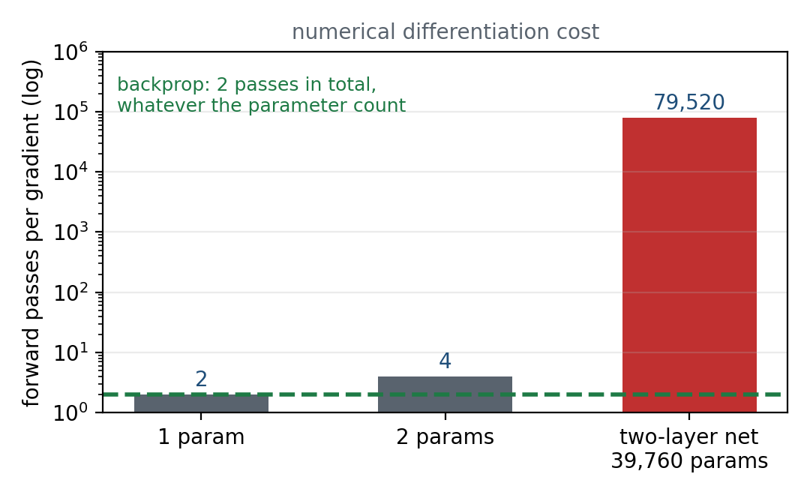

數值微分的優點是簡單、幾乎不會寫錯；缺點是太慢。第 3 章到第 6 章介紹的倒傳遞演算法，
不管參數有幾個，求一次梯度都只要正向 1 次、反向 1 次。第 7 章會在這個網路上實際計時。

---

# 第 3 章　計算圖

倒傳遞演算法 backpropagation（BP）可以用數學式推導，也可以用圖來理解。本書用圖：
把一串運算畫成計算圖 computational graph，圓圈是運算，箭頭上寫數值。

## 3.1 一個買蘋果的例子

**例題**：蘋果一個 100 元，買 2 個，另加 10% 的稅。要付多少錢？

心算就知道是 $100 \times 2 \times 1.1 = 220$ 元。故意選一個心算得出來的例子，是因為圖畫錯了會立刻知道。
畫成計算圖：

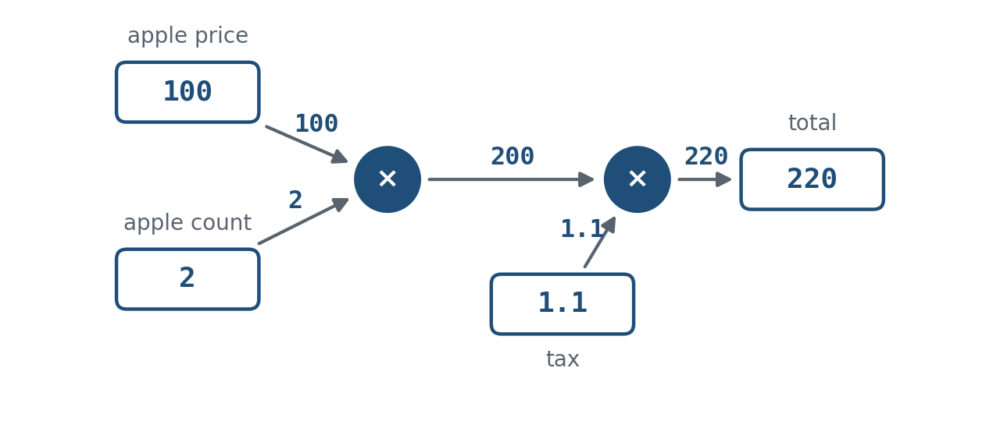

兩個圓圈都是乘法。蘋果價格 100 和個數 2 流進第一個乘法，得到小計 200；
200 和稅率 1.1 流進第二個乘法，得到總價 220。稅率寫成 1.1，是因為加 10% 的稅等於乘以 1.1。

## 3.2 正向傳播

從左往右一格一格算，叫正向傳播 forward propagation。這就是一般的計算方式，沒有新東西。
反過來從右往左傳，叫反向傳播；倒傳遞演算法就是在計算圖上做反向傳播。

## 3.3 局部計算

計算圖最重要的性質是：**每個節點只管自己這一格**。

假設除了蘋果之外，還買了很多其他東西，經過一連串計算總共 4000 元。整張圖變成：

| 節點 | 輸入 | 輸出 |
|---|---|---|
| 其他東西，經過一連串計算 | 很多東西的價格 | 4000 |
| 乘法 | 蘋果 100、個數 2 | 200 |
| 加法 | 4000、200 | 4200 |
| 乘法 | 4200、稅率 1.1 | 4620 |

加法節點只做 $4000 + 200 = 4200$，那 4000 是怎麼算出來的，它完全不必知道。
整張圖再大，每個節點要處理的事都一樣簡單。倒傳遞演算法能成立，靠的就是這個性質。

## 3.4 真正要問的問題

計算圖算出總價 220，並不是本書的目的。真正要問的是：

**每一個輸入動一點點，總價會動多少？**

也就是總價對蘋果價格、對個數、對稅率的導數。這三個導數就是三個輸入的梯度。
如果蘋果價格是模型的參數、總價是損失，這正是梯度下降需要的東西。
第 4 章說明怎麼從右往左把這些導數一次算出來。

---

# 第 4 章　鏈式法則與兩條節點規則

## 4.1 鏈式法則

一個函數由幾個函數接起來組成時，整體的導數等於各段導數相乘。這叫鏈式法則 chain rule。

以 $z = (x + y)^2$ 為例，拆成兩段：

$$t = x + y \qquad z = t^2$$

兩段各自的導數是

$$\frac{\partial z}{\partial t} = 2t \qquad \frac{\partial t}{\partial x} = 1$$

相乘就是整體的導數：

$$\frac{\partial z}{\partial x} = \frac{\partial z}{\partial t}\cdot\frac{\partial t}{\partial x} = 2t \cdot 1 = 2(x + y)$$

請記住這個例子：先相加得到 $t$，再平方。第 5 章的 $L(w) = (w-3)^2$ 是同一個結構，只是加 $y$ 換成減 3。

## 4.2 在計算圖上倒著傳

鏈式法則放到計算圖上，就變成一條很簡單的規則：

**從最右邊的 1 開始往左傳。每經過一個節點，把右邊傳來的值乘上這個節點的局部導數，再往左傳。**

右邊傳來的值叫「上游」的值。局部導數 local derivative 是這個節點自己的輸出對輸入的導數，
例如平方節點 $z = t^2$ 的局部導數是 $2t$。每個節點只需要知道自己的局部導數，這就是 3.3 節的局部計算。

整張計算圖不管多大，運算種類再多，最常用的只有兩種節點：加法與乘法。

## 4.3 加法節點：原封不動往兩邊傳

$$z = x + y \;\Rightarrow\; \frac{\partial z}{\partial x} = 1 \qquad \frac{\partial z}{\partial y} = 1$$

兩個局部導數都是 1，所以上游傳來什麼，就原封不動往兩邊傳。

**例**：$10 + 5 = 15$，上游傳來 1.3。往 $x$ 那邊傳 $1.3 \times 1 = 1.3$，往 $y$ 那邊也是 1.3。

## 4.4 乘法節點：乘以另一邊的輸入值

$$z = xy \;\Rightarrow\; \frac{\partial z}{\partial x} = y \qquad \frac{\partial z}{\partial y} = x$$

$z$ 對 $x$ 的導數是 $y$，對 $y$ 的導數是 $x$。所以往 $x$ 那邊傳的時候乘 $y$，往 $y$ 那邊傳的時候乘 $x$：
**乘以另一邊的輸入值**。

**例**：$10 \times 5 = 50$，上游傳來 1.3。往 $x$ 那邊傳 $1.3 \times 5 = 6.5$，往 $y$ 那邊傳 $1.3 \times 10 = 13$。

加法節點倒著傳時用不到正向的輸入，乘法節點用得到。所以寫乘法節點的程式時，
**正向時要把輸入記下來**，倒傳遞才拿得到另一邊的值。

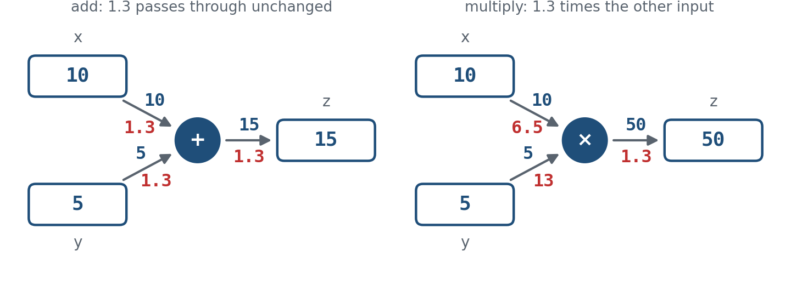

| 節點 | 正向 | 局部導數 | 倒傳遞的規則 | 上游傳來 1.3 時 |
|---|---|---|---|---|
| 加法 | $z = x + y$ | $1,\ 1$ | **原封不動**往兩邊傳 | $10 + 5$：兩邊都得到 1.3 |
| 乘法 | $z = xy$ | $y,\ x$ | 乘以**另一邊**的輸入值 | $10 \times 5$：$x$ 那邊得 6.5，$y$ 那邊得 13 |

---

# 第 5 章　手算練習

## 5.1 蘋果的倒傳遞

回到 3.1 節的計算圖，用第 4 章的兩條規則把下表填完。起點已經填好。

| 位置 | 正向的值 | 倒傳遞的值 | 怎麼算出來的 |
|---|---|---|---|
| 總價 | 220 | 1 | 起點 |
| 小計 | 200 | | |
| 稅率 | 1.1 | | |
| 蘋果價格 | 100 | | |
| 蘋果個數 | 2 | | |

填完之後對答案：

| 位置 | 正向的值 | 倒傳遞的值 | 怎麼算出來的 |
|---|---|---|---|
| 總價 | 220 | 1 | 起點 |
| 小計 | 200 | 1.1 | 第二個乘法節點，乘另一邊的稅率：$1 \times 1.1$ |
| 稅率 | 1.1 | 200 | 第二個乘法節點，乘另一邊的小計：$1 \times 200$ |
| 蘋果價格 | 100 | **2.2** | 第一個乘法節點，乘另一邊的個數：$1.1 \times 2$ |
| 蘋果個數 | 2 | 110 | 第一個乘法節點，乘另一邊的價格：$1.1 \times 100$ |

**2.2 是什麼意思**：蘋果每漲 1 元，總價就多 2.2 元。自己驗一次：把蘋果價格改成 101 再正向算，
$101 \times 2 \times 1.1 = 222.2$，比 220 多 2.2，和倒傳遞算的一樣。

稅率的導數是 200，比蘋果價格的 2.2 大得多，但兩者不能直接比大小：稅率的 1 代表 100% 的稅，
蘋果價格的 1 只是 1 元，單位不同。導數的大小要連同單位一起看。

## 5.2 蘋果加橘子

**例題**：買 2 個蘋果、3 個橘子，蘋果每個 100 元，橘子每個 150 元，另加 10% 的稅。

正向：蘋果 $100 \times 2 = 200$，橘子 $150 \times 3 = 450$，加法 $200 + 450 = 650$，乘稅率 $650 \times 1.1 = 715$。
中間多了一個加法節點，用第二條規則。把五個變數的導數都算出來：

| 變數 | 正向的值 | 倒傳遞的值 |
|---|---|---|
| 蘋果價格 | 100 | |
| 蘋果個數 | 2 | |
| 橘子價格 | 150 | |
| 橘子個數 | 3 | |
| 稅率 | 1.1 | |

**自己驗**：橘子漲 1 元，總價應該從 715 變成 718.3，差就是橘子價格的導數。其他四個變數也可以用同樣的方法驗。

填完之後對答案：

| 變數 | 倒傳遞的值 | 怎麼算出來的 |
|---|---|---|
| 稅率 | 650 | 乘法節點，乘另一邊的 650：$1 \times 650$ |
| 蘋果價格 | 2.2 | 加法節點原封不動傳 1.1，再乘另一邊的個數 2 |
| 蘋果個數 | 110 | 1.1 乘另一邊的價格 100 |
| 橘子價格 | 3.3 | 加法節點原封不動傳 1.1，再乘另一邊的個數 3 |
| 橘子個數 | 165 | 1.1 乘另一邊的價格 150 |

## 5.3 回到 L(w)

$L = (w-3)^2$ 拆成兩個節點：先減 3 得到 $t$，再平方得到 $L$。這和 4.1 節的 $(x+y)^2$ 是同一個結構。

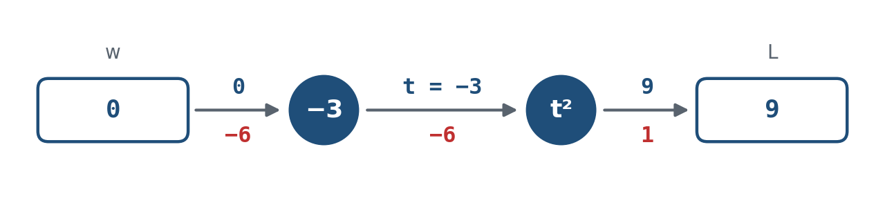

| 節點 | 正向 | 局部導數 |
|---|---|---|
| 減 3 | $t = w - 3$ | 1，和加法節點一樣原封不動往回傳 |
| 平方 | $L = t^2$ | $2t$，所以正向時要記住 $t$ |

鏈式法則把兩個局部導數乘起來：

$$\frac{dL}{dw} = \frac{dL}{dt}\cdot\frac{dt}{dw} = 2t \cdot 1 = 2(w-3)$$

和 1.2 節推出來的公式一樣。差別在這裡**沒有人推公式**，每個節點只知道自己的局部導數。

把下表填完，第一列已經填好：

| $w$ | 正向 $t$ | 正向 $L$ | 倒傳遞 $dL/dt = 2t$ | 倒傳遞 $dL/dw$ |
|---|---|---|---|---|
| 0 | −3 | 9 | −6 | −6 |
| 0.6 | | | | |
| 1.08 | | | | |

填完之後對答案：

| $w$ | 正向 $t$ | 正向 $L$ | 倒傳遞 $dL/dt$ | 倒傳遞 $dL/dw$ |
|---|---|---|---|---|
| 0 | −3 | 9 | −6 | −6 |
| 0.6 | −2.4 | 5.76 | −4.8 | −4.8 |
| 1.08 | −1.92 | 3.6864 | −3.84 | −3.84 |

最後一欄和 1.3 節手算表的梯度欄前三列一模一樣：0 → −6，0.6 → −4.8，1.08 → −3.84。

---

# 第 6 章　程式：手寫版與框架版

## 6.1 每種節點寫成一個類別

每種節點寫成一個「層」，只有兩個方法：`forward` 算正向，`backward` 算倒傳遞。

```python
class MulLayer:
    """乘法層：倒傳遞時乘以另一邊的輸入值。"""

    def __init__(self):
        self.x = None
        self.y = None

    def forward(self, x, y):
        self.x = x          # 正向時要記住輸入，倒傳遞會用到
        self.y = y
        return x * y

    def backward(self, dout):
        dx = dout * self.y  # 往 x 那邊乘 y
        dy = dout * self.x  # 往 y 那邊乘 x
        return dx, dy


class AddLayer:
    """加法層：倒傳遞時原封不動往兩邊傳。"""

    def forward(self, x, y):
        return x + y

    def backward(self, dout):
        return dout * 1, dout * 1
```

## 6.2 把蘋果的例子跑一次

```python
apple, apple_num, tax = 100, 2, 1.1

mul_apple_layer = MulLayer()
mul_tax_layer = MulLayer()

# 正向
apple_price = mul_apple_layer.forward(apple, apple_num)
price = mul_tax_layer.forward(apple_price, tax)

# 倒傳遞：呼叫順序和正向相反，起點是 1
dprice = 1
dapple_price, dtax = mul_tax_layer.backward(dprice)
dapple, dapple_num = mul_apple_layer.backward(dapple_price)

print(price)                    # 220.00000000000003
print(dapple, dapple_num, dtax) # 2.2 110.00000000000001 200
```

印出來的 `220.00000000000003` 與 `110.00000000000001` 不是算錯：1.1 在二進位裡存不精確，
乘出來就帶了一點捨入。數值上就是 220 與 110。

`backward` 的呼叫順序和 `forward` 相反，這就是「倒」傳遞。

## 6.3 蘋果加橘子

```python
orange, orange_num = 150, 3

mul_apple_layer = MulLayer()
mul_orange_layer = MulLayer()
add_apple_orange_layer = AddLayer()
mul_tax_layer = MulLayer()

# 正向：(1) (2) (3) (4)
apple_price = mul_apple_layer.forward(apple, apple_num)              # (1)
orange_price = mul_orange_layer.forward(orange, orange_num)          # (2)
all_price = add_apple_orange_layer.forward(apple_price, orange_price) # (3)
price = mul_tax_layer.forward(all_price, tax)                        # (4)

# 倒傳遞：(4) (3) (2) (1)，順序剛好相反
dall_price, dtax = mul_tax_layer.backward(1)                              # (4)
dapple_price, dorange_price = add_apple_orange_layer.backward(dall_price) # (3)
dorange, dorange_num = mul_orange_layer.backward(dorange_price)           # (2)
dapple, dapple_num = mul_apple_layer.backward(dapple_price)               # (1)
```

跑出來總價 715.0，五個導數是蘋果價格 2.2、蘋果個數 110、橘子價格 3.3、橘子個數 165、稅率 650，
和 5.2 節的答案相同。

## 6.4 L(w) 的兩個層

```python
class SubConstLayer:            # t = w - 3，局部導數是 1
    def __init__(self, c): self.c = c
    def forward(self, w):  return w - self.c
    def backward(self, dout): return dout * 1

class SquareLayer:              # L = t^2，局部導數是 2t
    def forward(self, t):  self.t = t; return t ** 2
    def backward(self, dout): return dout * 2 * self.t

def backprop_grad(w):
    sub, sq = SubConstLayer(3.0), SquareLayer()
    sq.forward(sub.forward(w))      # 正向
    dt = sq.backward(1.0)           # 倒傳遞從 1 開始
    return sub.backward(dt)

print(backprop_grad(0.0))       # -6.0
```

## 6.5 框架版：GradientTape 做的就是倒傳遞

```python
w = tf.Variable(0.0, dtype=tf.float64)
with tf.GradientTape() as tape:
    t = w - 3.0
    L = t ** 2
print(tape.gradient(L, w))      # -6.0
```

TensorFlow 的 `GradientTape` 把正向計算錄下來，再從最後面往回套鏈式法則，
做的就是 6.4 節那幾行的事，只是每一種運算的局部導數已經寫好了。
用 float64 跑，第 7 章那五個點和手寫版逐位相同，差是 0。

---

# 第 7 章　梯度確認

## 7.1 為什麼需要

倒傳遞很快，但每一種節點的 `backward` 都要自己寫，寫錯了**不會報錯**，數字照樣跑得出來。
數值微分很慢，但只有幾行，幾乎不會寫錯。所以拿慢的去驗快的：
兩種算法算同一個梯度，比較兩者是否一致。這個動作叫梯度確認 gradient check。

## 7.2 判準要先寫下來再跑

兩者的差不會剛好是 0，電腦的浮點數精度有限，總會留下一點捨入。寫對時差應該非常接近 0，
差很大就代表倒傳遞寫錯了。「多小算接近 0」要自己訂，**而且要在跑之前寫下來**；
不先定判準，看到什麼數字都會覺得合理。

本書訂為：**兩者差的絕對值小於 $10^{-7}$ 才算通過。** 理由在下面兩張表：
寫對時差在 $10^{-11}$ 以下，寫錯時差是 1 的數量級，門檻放在兩者中間。

## 7.3 L(w) 的梯度確認

五個 $w$ 取 1.3 節梯度下降實際走過的點：

| $w$ | 數值微分 | 倒傳遞 | 差的絕對值 | 判定 |
|---|---|---|---|---|
| 0.000000 | −6.000000000013 | −6.000000000000 | 1.27e−11 | 通過 |
| 0.600000 | −4.799999999996 | −4.800000000000 | 4.08e−12 | 通過 |
| 1.080000 | −3.839999999999 | −3.840000000000 | 6.00e−13 | 通過 |
| 1.464000 | −3.072000000000 | −3.072000000000 | 4.80e−13 | 通過 |
| 2.213568 | −1.572864000003 | −1.572864000000 | 3.45e−12 | 通過 |

## 7.4 故意寫錯一次

把平方節點的局部導數漏掉 2，寫成 $t$。這是最常見的錯法之一，程式不會報任何錯。

```python
class SquareLayerBug(SquareLayer):
    def backward(self, dout):
        return dout * self.t        # 漏了 2
```

| $w$ | 數值微分 | 寫錯的倒傳遞 | 差的絕對值 | 判定 |
|---|---|---|---|---|
| 0.000000 | −6.000000000013 | −3.000000000000 | 3.00 | 不通過 |
| 0.600000 | −4.799999999996 | −2.400000000000 | 2.40 | 不通過 |
| 1.080000 | −3.839999999999 | −1.920000000000 | 1.92 | 不通過 |

−3 看起來是個很合理的數字。更麻煩的是，**拿它去做梯度下降，損失照樣會降**：

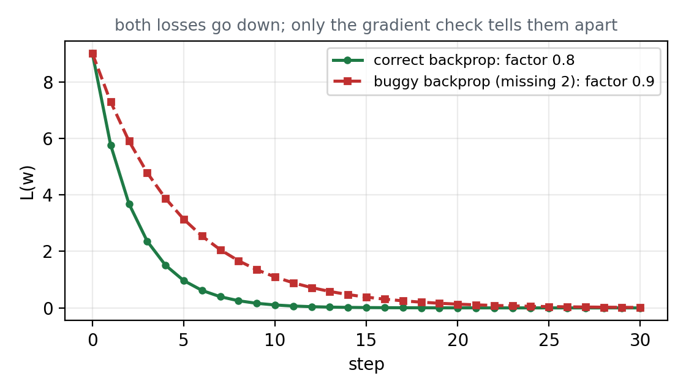

| $k$ | 正確的 $w$ | 寫錯的 $w$ |
|---|---|---|
| 0 | 0.000000 | 0.000000 |
| 1 | 0.600000 | 0.300000 |
| 2 | 1.080000 | 0.570000 |
| 3 | 1.464000 | 0.813000 |
| 6 | 2.213568 | 1.405677 |

正確版每一步離 3 的距離剩八成，寫錯版剩九成。寫錯的版本只是收斂得比較慢，
**只看損失有沒有下降，不會發現它錯了**。能抓到它的只有梯度確認。

## 7.5 在兩層網路上做一次

2.4 節那個 784–50–10 的網路，每一層的計算是：

| 層 | 正向 | 說明 |
|---|---|---|
| 第 1 層 | $a_1 = x W_1 + b_1$ | 784 個輸入乘權重加偏置，得 50 個值 |
| ReLU | $h = \max(0, a_1)$ | 負的改成 0 |
| 第 2 層 | $a_2 = h W_2 + b_2$ | 50 個值乘權重加偏置，得 10 個分數 |
| Softmax 與損失 | $y = \mathrm{softmax}(a_2)$，$L = -\sum t \log y$ | 分數轉成機率，再和正確答案比，見 7.6 節 |

每一層都照第 6 章的樣子寫成一個有 `forward` 與 `backward` 的類別，倒傳遞從損失往回一層一層傳。
三種層的 `backward` 都只是第 4 章兩條規則的延伸：

| 層 | 倒傳遞時做什麼 | 對應的規則 |
|---|---|---|
| Affine：$xW + b$ | 往 $W$ 那邊乘另一邊的 $x$，往 $x$ 那邊乘另一邊的 $W$；$b$ 原封不動，把每筆資料的加總起來 | 乘法節點與加法節點，換成矩陣 |
| ReLU：$\max(0, x)$ | 正向時大於 0 的位置原封不動傳，小於等於 0 的位置傳 0 | 局部導數是 1 或 0 |
| Softmax 與損失 | 直接傳回 $(y - t)/N$ | 7.6 節說明這個結果怎麼來 |

矩陣相乘時要轉置，形狀才對得上：$x$ 是 $N \times 784$、$W_1$ 是 $784 \times 50$，往 $W_1$ 傳的是 $x^{\mathsf T}$ 乘上游的值，
得到 $784 \times 50$，剛好和 $W_1$ 同形狀。

```python
class Affine:
    def __init__(self, W, b):
        self.W, self.b = W, b
        self.x = None
        self.dW = None
        self.db = None

    def forward(self, x):
        self.x = x                      # 記住輸入，倒傳遞要用
        return x @ self.W + self.b

    def backward(self, dout):
        self.dW = self.x.T @ dout       # 往 W 那邊：乘另一邊的 x
        self.db = dout.sum(axis=0)      # 往 b 那邊：原封不動，每筆加總
        return dout @ self.W.T          # 往 x 那邊：乘另一邊的 W


class Relu:
    def __init__(self):
        self.mask = None

    def forward(self, x):
        self.mask = x <= 0              # 記住哪些位置被改成 0
        out = x.copy()
        out[self.mask] = 0
        return out

    def backward(self, dout):
        dout = dout.copy()
        dout[self.mask] = 0             # 正向時是 0 的位置，倒傳遞也傳 0
        return dout


class SoftmaxWithLoss:
    def __init__(self):
        self.y = None
        self.t = None

    def forward(self, x, t):
        # log-sum-exp 寫法，不必在 log 裡加小數，理由見 7.6 節
        z = x - x.max(axis=1, keepdims=True)
        log_y = z - np.log(np.exp(z).sum(axis=1, keepdims=True))
        self.y = np.exp(log_y)
        self.t = t
        return -np.sum(t * log_y) / x.shape[0]

    def backward(self, dout=1):
        return (self.y - self.t) / self.t.shape[0]
```

把三種層接起來，就是整個網路。`gradient` 是倒傳遞，`numerical_gradient` 是 2.3 節的數值微分，
39,760 個參數一個一個動，每動一個就正向算兩次：

```python
class TwoLayerNet:
    def __init__(self, input_size, hidden_size, output_size, seed=0, weight_init_std=0.01):
        rng = np.random.default_rng(seed)
        self.params = {
            'W1': weight_init_std * rng.standard_normal((input_size, hidden_size)),
            'b1': np.zeros(hidden_size),
            'W2': weight_init_std * rng.standard_normal((hidden_size, output_size)),
            'b2': np.zeros(output_size),
        }
        self.n_forward = 0              # 數一數正向一共跑了幾次

    def loss(self, x, t):
        """正向：Affine → ReLU → Affine → Softmax 與損失。"""
        self.n_forward += 1
        p = self.params
        self.a1 = Affine(p['W1'], p['b1'])
        self.r1 = Relu()
        self.a2 = Affine(p['W2'], p['b2'])
        self.last = SoftmaxWithLoss()
        return self.last.forward(self.a2.forward(self.r1.forward(self.a1.forward(x))), t)

    def gradient(self, x, t):
        """倒傳遞：正向 1 次，再從最後一層往回傳 1 次。"""
        self.loss(x, t)
        dout = self.last.backward()
        dout = self.a2.backward(dout)
        dout = self.r1.backward(dout)
        self.a1.backward(dout)
        return {'W1': self.a1.dW, 'b1': self.a1.db, 'W2': self.a2.dW, 'b2': self.a2.db}

    def numerical_gradient(self, x, t, h=1e-4):
        """數值微分：每個參數動一下，正向算 2 次。"""
        grads = {}
        for key, P in self.params.items():      # W1、b1、W2、b2
            g = np.zeros_like(P)
            it = np.nditer(P, flags=['multi_index'])
            while not it.finished:
                i = it.multi_index
                keep = P[i]
                P[i] = keep + h
                fp = self.loss(x, t)            # 正向第 1 次
                P[i] = keep - h
                fm = self.loss(x, t)            # 正向第 2 次
                g[i] = (fp - fm) / (2 * h)
                P[i] = keep
                it.iternext()
            grads[key] = g
        return grads
```

實驗用 3 筆固定種子的隨機資料，不必下載資料集，梯度確認的道理完全相同。兩種算法各跑一次並計時：

```python
net = TwoLayerNet(784, 50, 10)
rng = np.random.default_rng(1)
x_batch = rng.random((3, 784))                      # 3 筆資料
t_batch = np.eye(10)[rng.integers(0, 10, size=3)]   # 正確答案，只有一個位置是 1

t0 = time.perf_counter()
grad_numerical = net.numerical_gradient(x_batch, t_batch)
t_num = time.perf_counter() - t0

grad_backprop = net.gradient(x_batch, t_batch)
t0 = time.perf_counter()
for _ in range(100):                    # 倒傳遞太快，跑 100 次取平均才量得準
    net.gradient(x_batch, t_batch)
t_bp = (time.perf_counter() - t0) / 100
```

結果：

| | 正向次數 | 時間，本書作者電腦上量的 |
|---|---|---|
| 數值微分 | 79,520 | 約 4 秒 |
| 倒傳遞 | 1，另加反向 1 次 | 約 0.0001 至 0.0002 秒 |

倒傳遞快了數萬倍。秒數每次跑都會因機器忙碌程度而不同，數量級才是重點，而且這只是梯度下降的一步。

參數有上萬個，逐一比較不實際。這裡把每一組參數兩種算法的差取絕對值，再取平均：

```python
for key in ('W1', 'b1', 'W2', 'b2'):
    diff = np.average(np.abs(grad_backprop[key] - grad_numerical[key]))
    print(key, diff)
```

| 參數 | 差的絕對值平均 | 判定 |
|---|---|---|
| W1 | 7.69e−13 | 通過 |
| b1 | 7.91e−13 | 通過 |
| W2 | 9.95e−13 | 通過 |
| b2 | 1.21e−10 | 通過 |

## 7.6 一個 $10^{-7}$ 也看得出來

網路的最後一層把 10 個分數 $a$ 轉成機率 $y$，再和正確答案 $t$ 比較：

$$y_k = \frac{e^{a_k}}{\sum_i e^{a_i}} \qquad L = -\frac{1}{N}\sum_{n}\sum_k t_{nk} \log y_{nk}$$

前者叫 Softmax，後者叫交叉熵 cross entropy，$N$ 是資料筆數，$t$ 是只有正確類別為 1、其餘為 0 的向量。
這兩個接在一起，倒傳遞的結果非常簡潔：

$$\frac{\partial L}{\partial a} = \frac{y - t}{N}$$

也就是「預測的機率減掉正確答案」。例如正確答案是 $(0, 1, 0)$、預測是 $(0.3, 0.2, 0.5)$，
倒傳遞送回去的就是 $(0.3, -0.8, 0.5)$：錯得越多，傳回去的值越大。這正是交叉熵被選來搭配 Softmax 的原因。

很多程式為了避免 $\log 0$ 變成負無限大，會在 log 裡加一個很小的數：

```python
return -np.sum(t * np.log(y + 1e-7)) / batch_size
```

問題就在這裡：$(y - t)/N$ 是 $-\sum t \log y$ 的**精確**導數，但正向實際算的是 $-\sum t \log(y + 10^{-7})$。
兩者差一點點，梯度確認就看得出來。實測加了 $10^{-7}$ 的寫法，b2 的差是 $1.4 \times 10^{-7}$，超過本書的判準。

本書的程式因此改用 log-sum-exp 的寫法，直接算出 $\log y$，不必在 log 裡加任何小數：

```python
z = a - a.max(axis=1, keepdims=True)
log_y = z - np.log(np.exp(z).sum(axis=1, keepdims=True))
loss = -np.sum(t * log_y) / N
```

改完之後才是 7.5 節那張表的數字。梯度確認連這麼細的不一致都抓得到，第 9 章練習 5 讓讀者自己試。

---

# 第 8 章　AI 時代，人在這裡做什麼

框架內建的運算不會漏掉那個 2，它們的局部導數都驗過了。會出錯的是**框架沒有替你寫的部分**：

| 情境 | 為什麼容易錯 |
|---|---|
| 自己寫的層 | 局部導數要自己推，漏一個係數、少轉置一次都不會報錯 |
| 自己寫的損失函數 | 像 7.6 節那個 $10^{-7}$，損失和梯度差一點點就對不上 |
| 自訂梯度 | 為了數值穩定或加速而手寫的 backward，最容易和 forward 不一致 |
| 生成式 AI 寫的 backward | 語法正確、形狀正確、數字看起來合理，但係數錯了 |

這四種錯的共同點是：**程式照跑，損失照降，只是學得比較慢或學到錯的地方**。7.4 節那張圖就是證據。

訓練停下來時也一樣。1.6 節說過，梯度變成 0 可能是極小值、可能是鞍點、也可能只是還在高原上。
程式不會告訴你是哪一種。

所以判斷「這份 backward 可不可以用」「這個模型可不可以交出去」的責任在人身上，而判斷的方法本書都給了：

| 要確認的事 | 方法 | 本書位置 |
|---|---|---|
| 梯度有沒有算對 | 梯度確認，先寫判準再比 | 第 7 章 |
| 停的地方是不是谷底 | 四個方向各動一點，看損失會不會降 | 1.6 節 |
| 有沒有更深的谷 | 換幾個起點，比較停下來的損失 | 1.6 節 |
| 是不是還在高原上 | 延長訓練，看損失會不會突然下降 | 1.6 節 |

---

# 第 9 章　練習

1. 5.2 節的蘋果加橘子：五個變數的導數都算出來，再用「漲 1 元」逐一自己驗。
2. 把 $L(w) = (w-3)^2$ 改成 $(w-5)^2$。計算圖哪一個節點的局部導數會變？倒傳遞的結果會變嗎？先預測再跑。
3. 寫一個 `CubeLayer`，正向是 $t^3$。它的 `backward` 要乘什麼？用梯度確認驗自己寫的對不對。
4. 7.5 節的 `numerical_gradient` 把 `h` 改成 $10^{-2}$ 再做一次梯度確認，差會變大還是變小？改成 $10^{-10}$ 呢？
   2.1 節的兩個問題各解釋其中一個。
5. 把 7.6 節的損失改回 `np.log(y + 1e-7)` 的寫法，再做一次梯度確認。哪一組參數的差變最大？
6. 1.6 節的 $L(w) = \dfrac{w^4}{4} - \dfrac{w^3}{3} - w^2$ 從 $w = 0$ 出發，梯度下降會停在哪裡？先算 $L'(0)$ 再回答。

**跑之前先寫下預測，再跑。** 預測錯比預測對更有價值，那代表對這個演算法的理解有一個洞。

---

# 附錄　程式取用

本書列出的程式就是全部的程式。為了讓讀者不必安裝任何東西就能跑一次，第 1、2、6、7 章的程式另外放在一份 Colab 筆記本上，
跑出來的每一個數字都和本書的表格相同：

* **直接在瀏覽器跑**：<https://colab.research.google.com/github/pychang-ai/115-1_DLMA/blob/main/topics/backprop/backprop.ipynb>
  不必下載、不必安裝、不需要圖形處理器；要改內容請先在 Colab 選「複製到雲端硬碟」，否則改動不會留下來。
* 本機執行：`python code/backprop.py`，需要 numpy、matplotlib、tensorflow

數值微分那一格要跑幾秒鐘，是正常的，那就是 2.4 節講的代價。

圖上的文字一律用英文。Colab 的預設環境沒有中文字型，用中文會變成方框。
