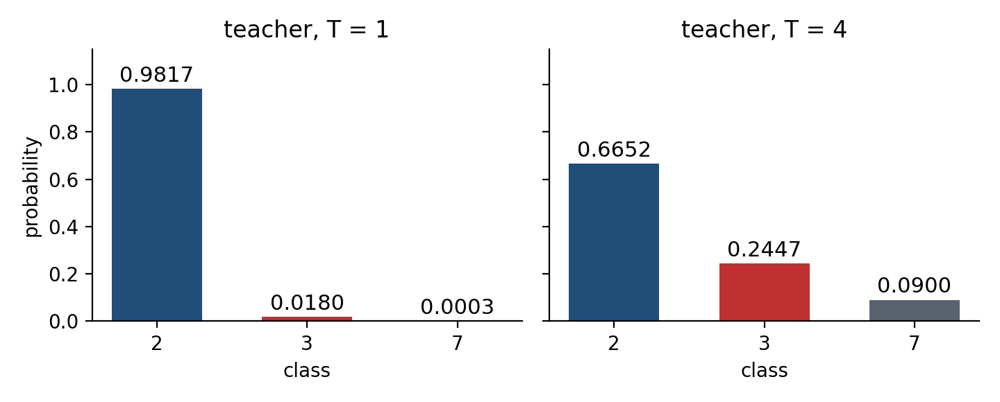
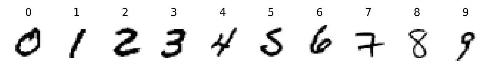
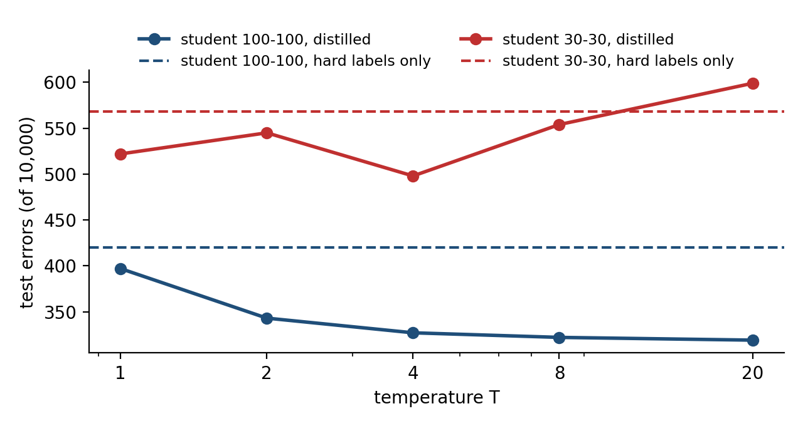

# Preface

This handout introduces knowledge distillation (KD): a training method that transfers the knowledge of a large model to a small model.
It is based on the 2015 paper \"Distilling the Knowledge in a Neural Network\" by Hinton, Vinyals, and Dean.
The equations, experimental settings, and results of the paper are all given in full here, so the reader does not need to consult the original paper.

The handout answers three questions:

1. Why should the knowledge of a large model be transferred to a small model?
2. During the transfer, what does the small model learn, how is the loss function written, and how is its gradient computed?
3. How well does the method work on handwritten digits?

Chapters 2 to 4 use one small set of made-up numbers and compute every step, so that each step can be checked with a calculator.
Chapter 5 repeats the MNIST experiments of the paper with a Colab program.

## How to use this handout

| Chapter | Content | Hands-on work |
|---|---|---|
| 1 | Why distill | — |
| 2 | Temperature and soft targets | the two tables in Section 2.3 |
| 3 | The distillation loss | the tables in Section 3.3 |
| 4 | The gradient, and its high-temperature limit | the table in Section 4.2 |
| 5 | MNIST experiments | run the Colab program once |
| 6 | Other results of the paper | — |
| 7 | Using the Colab program | — |
| 8 | Exercises and answers | three exercises |

## Terms and symbols

| Term | Paper\'s term | Symbol or abbreviation |
|---|---|---|
| knowledge distillation | distillation | KD |
| teacher model | cumbersome model | — |
| student model | distilled model | — |
| temperature | temperature | $T$ |
| soft targets | soft targets | $p$ |
| hard targets | hard targets | $y$ |
| transfer set | transfer set | — |
| cross entropy | cross entropy | $C$ |
| teacher\'s logits | logits | $v$ |
| student\'s logits | logits | $z$ |
| student\'s probabilities | — | $q$ |

# Chapter 1　Why Distill

## 1.1 Training and deployment have different requirements

Many insects have a larval form, suited to extracting energy and nutrients from the environment, and an adult form, suited to travelling and reproduction.
The paper uses this analogy for machine learning: the training stage and the deployment stage have different requirements, yet the same model is usually used for both.

| | Training stage | Deployment stage |
|---|---|---|
| Amount of data | very large and highly redundant | one input at a time |
| Time limit | may run for days | must respond in real time |
| Computing resources | many GPUs | a phone or a server |
| Suitable model | a large model or an ensemble | a small model |

A very large model can be used during training, for example an ensemble of models, or a single large model trained with a strong regularizer such as Dropout,
because such a model helps to extract structure from the data. After training, a different kind of training transfers the knowledge of the large model to a small model suitable for deployment.
This kind of training is called **distillation**. This handout calls the large model the **teacher** and the small model the **student**.

## 1.2 What knowledge is

The knowledge of a model is commonly identified with its parameters. Under this view, the knowledge cannot be kept once the architecture of the model is changed.

The paper takes a different view: the knowledge of a model is the **mapping from inputs to outputs** that it has learned. Under this view,
the knowledge has been transferred as soon as the student produces outputs similar to the teacher\'s for every input; the two architectures need not be the same.

## 1.3 The probabilities of wrong answers carry information

A classifier is trained to raise the probability of the correct class, but after training it also assigns a probability to every wrong class.
These probabilities are small, yet they differ in size and reflect how the model views the input. The paper gives two examples:

| Input | Mistaken for | Probability |
|---|---|---|
| a photo of a BMW | a garbage truck | very small |
| a photo of a BMW | a carrot | many times smaller than for the garbage truck |

| Input | Mistaken for a 3 | Mistaken for a 7 |
|---|---|---|
| a 2 written one way | $10^{-6}$ | $10^{-9}$ |
| a 2 written another way | $10^{-9}$ | $10^{-6}$ |

The second example shows that the first 2 looks more like a 3 and the second 2 looks more like a 7. This similarity between data cannot be obtained from the correct answers alone.
A large model usually generalizes to new data better than a small one; if the student learns these probabilities, it also learns how the teacher generalizes.

The difficulty is that $10^{-6}$ and $10^{-9}$ are both very close to 0. When the student is trained with the ordinary cross entropy, these two numbers have almost no influence on the loss, and the student does not learn them.
Caruana and his collaborators addressed this by training the student on the values before the teacher\'s softmax (the logits), using the squared difference as the loss.
The paper instead raises the **temperature** of the softmax; Section 4.4 shows that the former is a special case of the latter.

# Chapter 2　Temperature and Soft Targets

## 2.1 Softmax with temperature

The numbers produced by the last layer of a neural network are called logits; the logit of class $i$ is written $z_i$. The softmax converts the logits into probabilities $q_i$.
Equation (1) of the paper adds a temperature $T$ to the softmax:

$$q_i = \frac{\exp(z_i/T)}{\sum_j \exp(z_j/T)} \tag{1}$$

$T = 1$ gives the ordinary softmax. The larger $T$ is, the closer the class probabilities are to one another, and the more even the distribution.

## 2.2 The worked example

Chapters 2 to 4 use one set of made-up numbers. The input is a handwritten 2; to allow hand calculation, only the three classes \"2, 3, 7\" are used.

| Class | Teacher logit $v$ | Student logit $z$ | Correct answer $y$ |
|---|---|---|---|
| 2 | 8 | 4 | 1 |
| 3 | 4 | 2 | 0 |
| 7 | 0 | 2 | 0 |

The teacher is confident that this is a 2 and also considers a 3 more likely than a 7. The student can identify the 2 but gives 3 and 7 the same logit.
These numbers are made up for hand calculation; they are not the output of a real model.

## 2.3 Step-by-step computation

Equation (1) is computed in four steps: divide each logit by $T$, take the exponential, sum, and divide each value by the sum.

**$T = 1$**

| Class | $v$ | Step 1 $v/T$ | Step 2 $\exp(v/T)$ | Step 4 $p = \exp \div$ sum |
|---|---|---|---|---|
| 2 | 8 | 8.0000 | 2980.9580 | 0.9817 |
| 3 | 4 | 4.0000 | 54.5982 | 0.0180 |
| 7 | 0 | 0.0000 | 1.0000 | 0.0003 |
| Step 3 sum | | | 3036.5561 | |

**$T = 4$**

| Class | $v$ | Step 1 $v/T$ | Step 2 $\exp(v/T)$ | Step 4 $p = \exp \div$ sum |
|---|---|---|---|---|
| 2 | 8 | 2.0000 | 7.3891 | 0.6652 |
| 3 | 4 | 1.0000 | 2.7183 | 0.2447 |
| 7 | 0 | 0.0000 | 1.0000 | 0.0900 |
| Step 3 sum | | | 11.1073 | |



At $T = 1$ the probabilities of 3 and 7 are 0.0180 and 0.0003, both close to 0; at $T = 4$ they become 0.2447 and 0.0900.
Their ratio equals $\exp\big((4-0)/T\big)$: $e^4 = 54.60$ at $T = 1$ and $e^1 = 2.72$ at $T = 4$.
Raising the temperature does not change the order of the classes; it only reduces the differences between the probabilities, so that the probabilities of the wrong classes become large enough to affect training.

## 2.4 Soft targets and hard targets

The probabilities produced by the teacher at a high temperature are called **soft targets**; in this example, at $T = 4$, $p = (0.6652, 0.2447, 0.0900)$.
The correct answer itself is called the **hard target**; in this example, $y = (1, 0, 0)$.

The paper points out that when the soft targets have high entropy, each training case provides much more information than a hard target, and the gradient varies much less between training cases;
the student can therefore often be trained on much less data than the teacher and with a much higher learning rate.

The data used to train the student is called the **transfer set**. The transfer set may consist of unlabeled data, or the original training set may be used.
The paper found that using the original training set works well, especially when a small term for the correct answers is added to the loss; see Chapter 3.

# Chapter 3　The Distillation Loss

## 3.1 Two objective functions

The student\'s loss is a weighted average of two terms:

- **Soft-target term**: the cross entropy between the teacher\'s soft targets $p$ and the student\'s probabilities $q$. Both $p$ and $q$ are computed at **the same temperature** $T$.
$$C_{soft} = -\sum_i p_i \log q_i$$
- **Hard-target term**: the cross entropy between the correct answer and the student\'s probabilities at $T = 1$. Because $y$ is 1 only for the correct class, this term reduces to a single logarithm:
$$C_{hard} = -\log q^{(T=1)}_{\text{correct}}$$

The two terms use the same student logits and differ only in temperature. The total loss is

$$L = \alpha\, T^2\, C_{soft} + (1-\alpha)\, C_{hard}$$

## 3.2 The two coefficients

- $\alpha$ is the weight of the soft-target term. The paper reports that the best results are generally obtained with a considerably lower weight on the hard-target term. This handout uses $\alpha = 0.9$.
- $T^2$: the gradients produced by the soft-target term scale as $1/T^2$ (verified in Section 4.3). Multiplying by $T^2$ keeps the relative contributions of the two terms roughly unchanged when the temperature is changed during experiments.

After training, the student is used at a temperature of $T = 1$.

## 3.3 Step-by-step computation

**Step 1: the student\'s probabilities $q$ at $T = 4$**

| Class | $z$ | $z/4$ | $\exp(z/4)$ | $q$ |
|---|---|---|---|---|
| 2 | 4 | 1.0000 | 2.7183 | 0.4519 |
| 3 | 2 | 0.5000 | 1.6487 | 0.2741 |
| 7 | 2 | 0.5000 | 1.6487 | 0.2741 |
| Sum | | | 6.0157 | |

**Step 2: the soft-target term $C_{soft}$**

| Class | Teacher $p$ | $\log q$ | $p \times \log q$ |
|---|---|---|---|
| 2 | 0.6652 | −0.7944 | −0.5285 |
| 3 | 0.2447 | −1.2944 | −0.3168 |
| 7 | 0.0900 | −1.2944 | −0.1165 |
| Sum | | | −0.9618 |

$C_{soft} = -(-0.9618) = 0.9618$. Here $\log$ is the natural logarithm; each entry is rounded to four decimal places, and the sum is computed from the unrounded values.

**Step 3: the student\'s probabilities at $T = 1$ and the hard-target term $C_{hard}$**

| Class | $z$ | $\exp(z)$ | $q^{(T=1)}$ |
|---|---|---|---|
| 2 | 4 | 54.5982 | 0.7870 |
| 3 | 2 | 7.3891 | 0.1065 |
| 7 | 2 | 7.3891 | 0.1065 |
| Sum | | 69.3763 | |

The correct answer is 2, so $C_{hard} = -\log 0.7870 = 0.2395$.

**Step 4: the total loss**

| Term | Expression | Value |
|---|---|---|
| Soft-target term | $0.9 \times 4^2 \times 0.9618$ | 13.8493 |
| Hard-target term | $0.1 \times 0.2395$ | 0.0240 |
| Total loss $L$ | sum of the two terms | 13.8732 |

# Chapter 4　The Gradient, and Its High-Temperature Limit

## 4.1 Equation (2)

Training the student requires the gradient of the loss with respect to the student logits $z_i$. The gradient of the soft-target term is equation (2) of the paper:

$$\frac{\partial C_{soft}}{\partial z_i} = \frac{1}{T}\,(q_i - p_i) \tag{2}$$

Derivation: since $q = \mathrm{softmax}(z/T)$, $\log q_j = z_j/T - \log\sum_k \exp(z_k/T)$; differentiating with respect to $z_i$ gives
$\frac{\partial \log q_j}{\partial z_i} = \frac{1}{T}(\delta_{ij} - q_i)$, where $\delta_{ij}$ is 1 when $i=j$ and 0 otherwise. Substituting into $C_{soft}$:

$$\frac{\partial C_{soft}}{\partial z_i} = -\sum_j p_j \cdot \frac{1}{T}(\delta_{ij} - q_i) = \frac{1}{T}\Big(q_i \sum_j p_j - p_i\Big) = \frac{1}{T}(q_i - p_i)$$

The last step uses $\sum_j p_j = 1$. The same derivation at $T = 1$ gives the gradient of the hard-target term, $q^{(T=1)}_i - y_i$.

## 4.2 Step-by-step computation

| Class | $q - p$ | $\div T$ (eq. 2) | $\times \alpha T^2 = 14.4$ | $q^{(T=1)} - y$ | $\times (1-\alpha) = 0.1$ | Total gradient |
|---|---|---|---|---|---|---|
| 2 | −0.2134 | −0.0533 | −0.7682 | −0.2130 | −0.0213 | −0.7895 |
| 3 | 0.0293 | 0.0073 | 0.1056 | 0.1065 | 0.0107 | 0.1163 |
| 7 | 0.1840 | 0.0460 | 0.6625 | 0.1065 | 0.0107 | 0.6732 |

Gradient descent updates the parameters in the direction opposite to the gradient: the logit of 2 increases, the logit of 7 decreases the most, and the logit of 3 decreases only slightly.
The student therefore moves toward the teacher\'s view: \"2 most likely, 3 second, 7 least likely\". With the hard-target term alone, the gradients for 3 and 7 are equal (both 0.1065), and the student cannot learn the difference between them.

Section 3 of the Colab program recomputes these numbers with TensorFlow\'s automatic differentiation `GradientTape` and obtains the same loss, 13.8732, and the same total gradient.

## 4.3 Why multiply by $T^2$

Equation (2) computed for the same logits at three temperatures:

| $T$ | Largest absolute value of the gradient in eq. (2) | After multiplying by $T^2$ |
|---|---|---|
| 1 | 0.194704 | 0.1947 |
| 4 | 0.053345 | 0.8535 |
| 20 | 0.002637 | 1.0547 |

When $T$ rises from 4 to 20, the gradient shrinks by a factor of about 20, close to $(20/4)^2 = 25$; after multiplying by $T^2$ the values are 0.85 and 1.05, of similar size.
The $1/T^2$ scaling results from the high-temperature approximation in the next section; $T = 1$ is outside the range of that approximation.

## 4.4 At high temperature, distillation matches logits

When $x$ is small, $\exp(x) \approx 1 + x$. If the temperature is high compared with the logits, $z_i/T$ and $v_i/T$ are both small, and equation (2) can be approximated by equation (3) of the paper:

$$\frac{\partial C_{soft}}{\partial z_i} \approx \frac{1}{T}\left(\frac{1 + z_i/T}{N + \sum_j z_j/T} - \frac{1 + v_i/T}{N + \sum_j v_j/T}\right) \tag{3}$$

$N$ is the number of classes. If, in addition, the teacher\'s and the student\'s logits have each been zero-meaned, that is, $\sum_j z_j = \sum_j v_j = 0$, equation (3) simplifies to equation (4):

$$\frac{\partial C_{soft}}{\partial z_i} \approx \frac{1}{N T^2}\,(z_i - v_i) \tag{4}$$

This is the gradient of $\frac{1}{2}(z_i - v_i)^2$ multiplied by the constant $\frac{1}{NT^2}$. In other words, **distillation at a high temperature makes the student\'s logits match the teacher\'s logits directly**.
Equation (4) also explains the $1/T^2$ of Section 4.3.

Check with the example: after subtracting the means, $z = (1.3333, -0.6667, -0.6667)$ and $v = (4, 0, -4)$; $N = 3$ and $T = 20$.

| Class | Eq. (2), exact | Eq. (4), approximate |
|---|---|---|
| 2 | −0.00229 | −0.00222 |
| 3 | −0.00034 | −0.00056 |
| 7 | 0.00264 | 0.00278 |

At lower temperatures, equation (2) pays much less attention to matching logits that are much more negative than the average. This can be an advantage, because these logits are almost unconstrained by the loss used to train the teacher and may be very noisy;
it can also be a disadvantage, because they may carry useful knowledge of the teacher. The paper found that when the student is much too small to capture all of the teacher\'s knowledge, intermediate temperatures work best, which suggests that ignoring the very negative logits helps (Section 5.4).

# Chapter 5　MNIST Experiments

## 5.1 Settings and results in the paper

MNIST consists of 28×28 grayscale images of handwritten digits: 60,000 training images and 10,000 test images. The settings of Section 3 of the paper:

| | Architecture | Regularization | Test errors |
|---|---|---|---|
| Teacher | two hidden layers of 1,200 ReLU units | Dropout, weight constraints, input images shifted randomly by up to 2 pixels | 67 |
| Student, hard labels only | two hidden layers of 800 ReLU units | none | 146 |
| Student, distilled at $T = 20$ | same as above | only the soft targets of distillation | 74 |

Distillation reduces the student\'s errors from 146 to 74, close to the teacher\'s 67.
The teacher\'s training data was shifted and the student\'s transfer set was not, yet the student learned how the teacher handles shifted images, because this information is contained in the soft targets.

The paper reports two further results:

1. When the student has 300 or more units per hidden layer, all temperatures above 8 give similar results; when it is reduced to 30 units per layer, temperatures from 2.5 to 4 work significantly better than higher or lower ones.
2. When all 3s are removed from the transfer set, the student never sees a 3. The distilled student still makes only 206 test errors, 133 of which are among the 1,010 threes in the test set.
   Most of these errors are caused by a learned bias for class 3 that is too low; after this bias is increased by 3.5 (a value chosen on the test set), the errors fall to 109, of which only 14 are 3s, so 98.6% of the 3s are correct.
   If the transfer set contains only the 7s and 8s, the student has a 47.3% test error rate; after the biases of 7 and 8 are reduced by 7.6, it falls to 13.2%.

## 5.2 The repetition in this handout

The Colab program of this handout repeats the three results above. To finish within a few minutes on the free tier of Colab, the data and the students are smaller:

| | Paper | This handout |
|---|---|---|
| Training data | 60,000 images | 10,000 images, 1,000 of each digit |
| Test data | 10,000 images | the same 10,000 test images, including 1,010 threes |
| Teacher | 1200-1200, Dropout, 2-pixel shifts | 1200-1200, Dropout, 2-pixel shifts |
| Student | 800-800; also 30-30 | 100-100; also 30-30 |
| Temperature | 20, plus several others | 1, 2, 4, 8, 20 |
| $\alpha$ | low weight on hard targets | 0.9 |



The numbers below were obtained on 19 October 2026 by running the Colab program on a local CPU (Python 3.13, TensorFlow 2.21, Keras 3.13).
Running it on Colab gives slightly different numbers.

## 5.3 Result 1: the distilled student makes fewer errors

| Model | Test errors |
|---|---|
| Teacher 1200-1200 | 222 |
| Student 100-100, hard labels only | 420 |
| Student 100-100, distilled at $T = 20$ | 319 |

The gap between the student and the teacher shrinks from 198 to 97 errors.

## 5.4 Result 2: a very small student works best at an intermediate temperature

| $T$ | Student 100-100 | Student 30-30 |
|---|---|---|
| hard labels only | 420 | 568 |
| 1 | 397 | 522 |
| 2 | 343 | 545 |
| 4 | 327 | **498** |
| 8 | 322 | 554 |
| 20 | **319** | 599 |



Student 100-100 makes fewer errors than with hard labels only at every temperature, and the higher the temperature the better. Student 30-30 is best at $T = 4$; at $T = 20$ it makes more errors than with hard labels only.
This agrees with the paper: the higher the temperature, the closer distillation is to the logit matching of Section 4.4, which also requires matching very negative logits, and a student with too little capacity cannot do so.

## 5.5 Result 3: a student that has never seen a 3

All 3s are removed from the transfer set, leaving 9,000 images. Student 100-100.

| Model | Total errors | Errors on 3s | 3s correct |
|---|---|---|---|
| Hard labels only | 1372 | 1010 / 1010 | 0.0% |
| Distilled at $T = 8$ | 727 | 457 / 1010 | 54.8% |
| Distilled at $T = 8$, 3.0 added to the logit of 3 | 442 | 104 / 1010 | 89.7% |

The student trained on hard labels only has never been given the answer 3 and cannot answer 3.
The distilled student has not seen a 3 either, but the teacher\'s soft targets for the other digits still contain information of the form \"this image looks somewhat like a 3\", so the student recognizes more than half of the 3s;
after the bias correction, almost 90% are correct. The amount added was chosen on the test set, as in the paper, so this number is optimistic.

# Chapter 6　Other Results of the Paper

The numbers in this chapter are taken from the paper; this handout does not repeat these experiments.

## 6.1 Speech recognition

The baseline is the acoustic model used by Android voice search (8 hidden layers of 2,560 units, 14,000 output classes, about 85 million parameters).
Ten models with the same architecture and different initial values were trained independently, and the ensemble of the ten was distilled into a single model of the same size.

| System | Test frame accuracy | Word error rate (WER) |
|---|---|---|
| Single model | 58.9% | 10.9% |
| Ensemble of 10 models | 61.1% | 10.7% |
| Distilled single model | 60.8% | 10.7% |

More than 80% of the improvement achieved by the ensemble of 10 models is transferred to the single model.

## 6.2 Soft targets as a regularizer

The same speech model trained on only 3% of the training data (about 20 million examples):

| Training | Training data | Train frame accuracy | Test frame accuracy |
|---|---|---|---|
| Hard targets | 100% | 63.4% | 58.9% |
| Hard targets | 3% | 67.3% | 44.5% |
| Soft targets | 3% | 65.4% | 57.0% |

With hard targets alone the model overfits severely and early stopping is needed. With soft targets obtained from a model trained on all the data, 3% of the data comes close to the result of the full data, without early stopping.

## 6.3 Specialist models

On the JFT dataset of 100 million images and 15,000 classes, the paper also trains 61 specialist models.
Each specialist handles a group of easily confused classes (for example, many types of bridges or many car models), with all other classes merged into one \"dustbin\" class.
The specialists are initialized with the weights of the original model and can be trained independently and in parallel within a few days.
Combined with the original model, they raise the test accuracy from 25.0% to 26.1%; on the classes covered by the specialists, from 43.1% to 45.9%.

# Chapter 7　Using the Colab Program

Open `knowledge_distillation_en.ipynb` in Colab and run the cells from top to bottom. The complete program is listed in the appendix of this handout. It has eight sections:

| Section | Content | Section of this handout |
|---|---|---|
| 1 | Load the data | 5.2 |
| 2 | Worked example of softmax with temperature | 2.3 |
| 3 | Worked example of the loss and gradient, checked with automatic differentiation | 3.3, 4.2, 4.3, 4.4 |
| 4 | Train the teacher | 5.2 |
| 5 | Temperatures for student 100-100 | 5.3, 5.4 |
| 6 | Temperatures for student 30-30 | 5.4 |
| 7 | A student that has never seen a 3 | 5.5 |
| 8 | Summary of results | — |

The data file `kd_mnist.npz` (about 3.3 MB) can be obtained in two ways; the program checks which one applies:

1. Drag the provided `kd_mnist.npz` into the \"Files\" panel on the left of Colab, so that it is in the default folder `/content`.
2. If the file is not in the panel, the program downloads the same file from the GitHub repository of this module.

On a CPU the whole program takes a few minutes; a GPU (\"Runtime → Change runtime type → T4 GPU\") is faster.

# Chapter 8　Exercises and Answers

**Exercise 1**　At $T = 2$, what are the soft targets of the teacher logits $v = (8, 4, 0)$? Use the four steps of Section 2.3.

**Exercise 2**　Change the student logits to $z = (8, 4, 0)$, identical to the teacher\'s, with $T = 4$. What is the gradient in equation (2), and why?

**Exercise 3**　In Section 7 of the Colab program, remove the digit 7 instead and repeat the experiment. Record the percentage of 7s classified correctly, before and after adding a bias.

**Answer 1**　$v/2 = (4, 2, 0)$; the exponentials are $(54.5982, 7.3891, 1.0000)$; the sum is 62.9873;
the soft targets are $p = (0.8668, 0.1173, 0.0159)$. They are more even than at $T = 1$ and more concentrated than at $T = 4$.

**Answer 2**　The student\'s logits equal the teacher\'s, so $q = p$ at the same temperature, every $q_i - p_i$ in equation (2) is 0, and the gradient of the soft-target term is $(0, 0, 0)$: the student already matches the teacher exactly, and the soft-target term no longer moves it.
The total gradient consists only of the hard-target term, $0.1 \times (q^{(T=1)} - y) = 0.1 \times (0.9817 - 1,\ 0.0180,\ 0.0003) = (-0.0018, 0.0018, 0.0000)$.

**Answer 3**　The result depends on each training run and has no fixed answer. Record the total number of errors, the number of errors on 7s, and the bias that was added.


# Appendix　The Complete Program

The complete code of the Colab program `knowledge_distillation_en.ipynb`, in order of execution; the headings follow the sections of the program.

**1. Load the data**

```python
import os
import urllib.request

import numpy as np

np.set_printoptions(suppress=True)  # print decimals without scientific notation, as on the slides

DATA = 'kd_mnist.npz'
URL = ('https://raw.githubusercontent.com/pychang-ai/115-1_DLMA/main/'
       'topics/knowledge-distillation/kd_mnist.npz')

if os.path.exists(DATA):
    print('Using the uploaded', DATA)
else:
    print(DATA, 'not found; downloading it from the GitHub repository')
    urllib.request.urlretrieve(URL, DATA)

d = np.load(DATA)
x_train = d['x_train'].reshape(-1, 784).astype('float32') / 255.0
y_train = d['y_train'].astype('int32')
x_test = d['x_test'].reshape(-1, 784).astype('float32') / 255.0
y_test = d['y_test'].astype('int32')
print('train', x_train.shape, 'test', x_test.shape)
print('training images per digit', np.bincount(y_train))
print('test images per digit    ', np.bincount(y_test))
```

```python
import matplotlib.pyplot as plt

fig, axes = plt.subplots(1, 10, figsize=(12, 1.6))
for k, ax in enumerate(axes):
    i = np.where(y_train == k)[0][0]
    ax.imshow(x_train[i].reshape(28, 28), cmap='gray_r')
    ax.set_title(str(k))
    ax.axis('off')
plt.show()
```

**2. Softmax with temperature**

```python
def softmax_T(z, T):
    """Equation (1): softmax at temperature T, returning every intermediate step."""
    z = np.asarray(z, dtype='float64')
    a = z / T
    e = np.exp(a)
    s = e.sum()
    return a, e, s, e / s


v = [8.0, 4.0, 0.0]
for T in [1, 4]:
    a, e, s, p = softmax_T(v, T)
    print(f'T = {T}')
    print('  step 1  z/T       ', np.round(a, 4))
    print('  step 2  exp(z/T)  ', np.round(e, 4))
    print('  step 3  sum       ', round(s, 4))
    print('  step 4  probability', np.round(p, 4))
    print(f'  ratio of P(3) to P(7): {p[1] / p[2]:.2f}')
```

```python
labels = ['2', '3', '7']
fig, axes = plt.subplots(1, 2, figsize=(8, 2.8), sharey=True)
for ax, T in zip(axes, [1, 4]):
    p = softmax_T(v, T)[3]
    ax.bar(labels, p, color=['#1F4E79', '#C03030', '#59636E'])
    for k, val in enumerate(p):
        ax.text(k, val + 0.02, f'{val:.4f}', ha='center')
    ax.set_title(f'teacher softmax, T = {T}')
    ax.set_ylim(0, 1.1)
plt.show()
```

**3. The distillation loss and its gradient**

```python
T, alpha = 4.0, 0.9
z = np.array([4.0, 2.0, 2.0])
p = softmax_T(v, T)[3]          # teacher's soft targets
q = softmax_T(z, T)[3]          # student at T = 4
q1 = softmax_T(z, 1)[3]         # student at T = 1
y = np.array([1.0, 0.0, 0.0])   # the correct answer is 2

c_soft = -(p * np.log(q)).sum()
c_hard = -(y * np.log(q1)).sum()
loss = alpha * T ** 2 * c_soft + (1 - alpha) * c_hard
print('teacher soft targets p ', np.round(p, 4))
print('student q (T=4)        ', np.round(q, 4))
print('student q (T=1)        ', np.round(q1, 4))
print(f'C_soft = {c_soft:.4f}   C_hard = {c_hard:.4f}')
print(f'L = {alpha} × {T:g}² × {c_soft:.4f} + {1 - alpha:.1f} × {c_hard:.4f} = {loss:.4f}')

g_soft = (q - p) / T            # equation (2)
g_hard = q1 - y                 # gradient of the ordinary cross entropy
g = alpha * T ** 2 * g_soft + (1 - alpha) * g_hard
print()
print('soft-target gradient (q - p)/T, eq. (2)', np.round(g_soft, 4))
print('hard-target gradient q1 - y            ', np.round(g_hard, 4))
print('total gradient                         ', np.round(g, 4))
```

```python
import tensorflow as tf

zt = tf.Variable(z)
with tf.GradientTape() as tape:
    qt = tf.nn.log_softmax(zt / T)
    q1t = tf.nn.log_softmax(zt)
    L = alpha * T ** 2 * -tf.reduce_sum(p * qt) + (1 - alpha) * -tf.reduce_sum(y * q1t)
print('loss from automatic differentiation    ', round(float(L), 4))
print('gradient from automatic differentiation', np.round(tape.gradient(L, zt).numpy(), 4))
```

```python
for t in [1, 4, 20]:
    gs = (softmax_T(z, t)[3] - softmax_T(v, t)[3]) / t
    print(f'T = {t:>2}  largest |gradient| {np.abs(gs).max():.6f}   after multiplying by T² {np.abs(gs).max() * t * t:.4f}')
```

```python
N, T = 3, 20.0
zc, vc = z - z.mean(), np.array(v) - np.mean(v)
exact = (softmax_T(zc, T)[3] - softmax_T(vc, T)[3]) / T
approx = (zc - vc) / (N * T ** 2)
print('after subtracting the mean  z =', np.round(zc, 4), '  v =', np.round(vc, 4))
print('equation (2), exact      ', np.round(exact, 5))
print('equation (4), approximate', np.round(approx, 5))
```

**4. Train the teacher**

```python
import keras
from keras import layers

keras.utils.set_random_seed(1)


def mlp(units, regularize=False, name='mlp'):
    """Fully connected network with two hidden layers and 10 output logits. regularize=True adds shifts and Dropout."""
    inp = keras.Input((784,))
    x = inp
    if regularize:
        x = layers.Reshape((28, 28, 1))(x)
        x = layers.RandomTranslation(2 / 28, 2 / 28, fill_mode='constant')(x)
        x = layers.Flatten()(x)
        x = layers.Dropout(0.2)(x)
    for _ in range(2):
        x = layers.Dense(units, activation='relu')(x)
        if regularize:
            x = layers.Dropout(0.5)(x)
    out = layers.Dense(10)(x)
    return keras.Model(inp, out, name=name)


def test_errors(model, bias=None):
    """Return the number of test errors and the logits. bias is added to the logits of each class."""
    logits = model.predict(x_test, batch_size=2000, verbose=0)
    if bias is not None:
        logits = logits + bias
    return int((logits.argmax(1) != y_test).sum()), logits


teacher = mlp(1200, regularize=True, name='teacher')
teacher.compile(keras.optimizers.Adam(1e-3),
                keras.losses.SparseCategoricalCrossentropy(from_logits=True))
teacher.fit(x_train, y_train, batch_size=128, epochs=30, verbose=0)
teacher_err, _ = test_errors(teacher)
print(f'teacher: {teacher.count_params():,} parameters, {teacher_err} errors on the 10,000 test images')

# teacher logits on the transfer set (the training set); every student uses this copy
v_train = teacher.predict(x_train, batch_size=2000, verbose=0)
```

**5. Student trained on hard labels only, compared with distillation**

```python
def train_student(units, T, alpha, mask=None, epochs=30, seed=2):
    """Train a student with L = α T² C_soft + (1 − α) C_hard. mask removes part of the transfer set."""
    keras.utils.set_random_seed(seed)
    student = mlp(units, name='student')
    opt = keras.optimizers.Adam(1e-3)
    x, yy, vv = (x_train, y_train, v_train) if mask is None else \
        (x_train[mask], y_train[mask], v_train[mask])
    ds = tf.data.Dataset.from_tensor_slices((x, yy, vv)).shuffle(len(x), seed=seed).batch(128)

    @tf.function
    def step(xb, yb, vb):
        with tf.GradientTape() as tape:
            zb = student(xb, training=True)
            pb = tf.nn.softmax(vb / T)                                     # teacher's soft targets
            c_soft = -tf.reduce_mean(tf.reduce_sum(pb * tf.nn.log_softmax(zb / T), 1))
            c_hard = tf.reduce_mean(tf.nn.sparse_softmax_cross_entropy_with_logits(
                labels=yb, logits=zb))
            loss = alpha * T * T * c_soft + (1 - alpha) * c_hard
        grads = tape.gradient(loss, student.trainable_variables)
        opt.apply_gradients(zip(grads, student.trainable_variables))

    for _ in range(epochs):
        for xb, yb, vb in ds:
            step(xb, yb, vb)
    return student


TEMPS = [1, 2, 4, 8, 20]
results = {}
s = train_student(100, 1.0, 0.0)
results[(100, 'hard')] = test_errors(s)[0]
print(f'student 100, hard labels only: {results[(100, "hard")]} errors')
for t in TEMPS:
    s = train_student(100, float(t), 0.9)
    results[(100, t)] = test_errors(s)[0]
    print(f'student 100, distilled at T = {t:>2}: {results[(100, t)]} errors')
```

**6. A smaller student: intermediate temperatures work best**

```python
s = train_student(30, 1.0, 0.0)
results[(30, 'hard')] = test_errors(s)[0]
print(f'student 30, hard labels only: {results[(30, "hard")]} errors')
for t in TEMPS:
    s = train_student(30, float(t), 0.9)
    results[(30, t)] = test_errors(s)[0]
    print(f'student 30, distilled at T = {t:>2}: {results[(30, t)]} errors')
```

**7. A student that has never seen the digit 3**

```python
mask = y_train != 3
print('images in the transfer set:', int(mask.sum()), '; of which digit 3:', int((y_train[mask] == 3).sum()))


def threes_wrong(logits):
    return int(((logits.argmax(1) != y_test) & (y_test == 3)).sum())


for name, t, a in [('hard labels only', 1.0, 0.0), ('distilled at T = 8', 8.0, 0.9)]:
    s = train_student(100, t, a, mask=mask)
    err, logits = test_errors(s)
    best = None
    for b in np.arange(0, 15.01, 0.25):
        shift = np.zeros(10, 'float32')
        shift[3] = b
        e = int(((logits + shift).argmax(1) != y_test).sum())
        if best is None or e < best[0]:
            best = (e, b, threes_wrong(logits + shift))
    results[('no3', name)] = (err, threes_wrong(logits), best)
    print(f'{name}: {err} errors, of which {threes_wrong(logits)} / 1010 are 3s')
    print(f'    after adding {best[1]:.2f} to the logit of 3: {best[0]} errors, of which {best[2]} / 1010 are 3s'
          f' ({100 * (1 - best[2] / 1010):.1f}% of 3s correct)')
```

**8. Summary of results**

```python
print(f'{"model":<34}{"test errors":>12}')
print(f'{"teacher 1200-1200":<34}{teacher_err:>12}')
for units in [100, 30]:
    print(f'{"student %d, hard labels only" % units:<34}{results[(units, "hard")]:>12}')
    best_t = min(TEMPS, key=lambda t: results[(units, t)])
    print(f'{"student %d, distilled, best T=%d" % (units, best_t):<34}{results[(units, best_t)]:>12}')

fig, ax = plt.subplots(figsize=(7, 3.2))
for units, color in [(100, '#1F4E79'), (30, '#C03030')]:
    ax.plot(TEMPS, [results[(units, t)] for t in TEMPS], 'o-', color=color,
            label=f'student {units}-{units}, distilled')
    ax.axhline(results[(units, 'hard')], color=color, ls='--', label=f'student {units}-{units}, hard labels only')
ax.set_xscale('log')
ax.set_xticks(TEMPS)
ax.set_xticklabels([str(t) for t in TEMPS])
ax.set_xlabel('temperature T')
ax.set_ylabel('test errors (of 10,000)')
ax.legend(fontsize=8)
plt.show()
```

# References

1. G. Hinton, O. Vinyals, J. Dean, \"Distilling the Knowledge in a Neural Network,\" arXiv:1503.02531, 2015.
2. C. Buciluǎ, R. Caruana, A. Niculescu-Mizil, \"Model compression,\" in *Proc. 12th ACM SIGKDD*, 2006, pp. 535–541.
3. Y. LeCun, C. Cortes, C. J. C. Burges, The MNIST database of handwritten digits.
