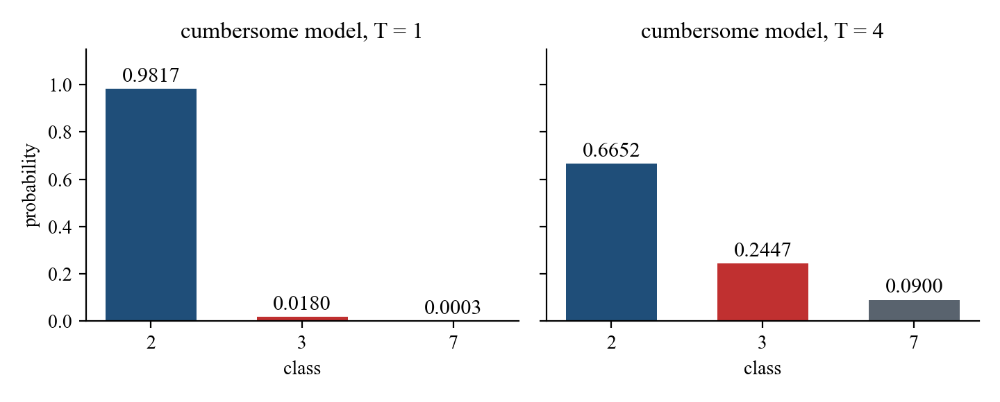
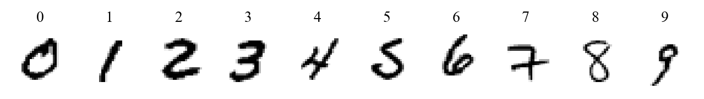
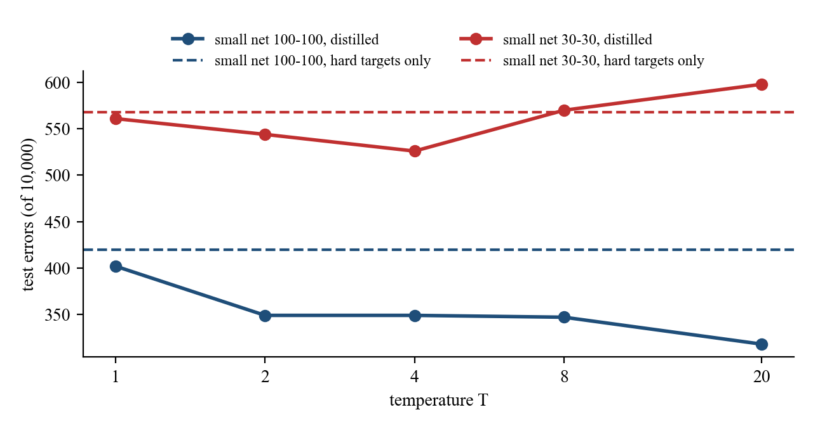

# Preface

This handout presents knowledge distillation as introduced by Hinton, Vinyals, and Dean in "Distilling the Knowledge in a Neural Network" (2015).
We follow the paper closely: its equations, experimental settings, and results are given here in full, so the reader does not need to consult the original.
In addition, we work through the equations by hand on a small example and repeat the MNIST experiments of the paper in a Colab notebook.

We address three questions:

1. Why should the knowledge of a cumbersome model be transferred to a small model?
2. What objective function is used to train the small model, and what is its gradient?
3. How well does distillation work on MNIST?

Sections 2 to 4 use one small set of logits and compute every step, so that each number can be checked with a calculator.
Section 5 repeats the preliminary experiments on MNIST using the notebook that accompanies this handout.

## How to use this handout

| Section | Content | Work to do |
|---|---|---|
| 1 | Introduction | — |
| 2 | Softmax with a temperature and soft targets | the two tables in Section 2.3 |
| 3 | The distillation objective | the tables in Section 3.3 |
| 4 | Gradients and matching logits | the table in Section 4.2 |
| 5 | Preliminary experiments on MNIST | run the notebook once |
| 6 | Other results of the paper | — |
| 7 | The notebook | — |
| 8 | Exercises and answers | three exercises |

## Notation

| Term | Symbol |
|---|---|
| temperature | $T$ |
| logits of the cumbersome model | $v$ |
| logits of the distilled model | $z$ |
| soft targets: class probabilities of the cumbersome model at temperature $T$ | $p$ |
| class probabilities of the distilled model at temperature $T$ | $q$ |
| hard targets: the correct labels | $y$ |
| cross entropy with the soft targets and with the hard targets | $C_{soft}$, $C_{hard}$ |
| weight of the soft-target objective | $\alpha$ |
| number of classes | $N$ |
| softmax: the function that converts logits into class probabilities that sum to 1 | — |
| regularization: methods that constrain a model during training so that it does not fit the training data too closely (overfitting), e.g. dropout or weight constraints | — |
| dropout: a regularizer that randomly drops a fraction of the units on each training case; it can be viewed as training a very large ensemble of models that share weights | — |
| generalization: the ability of a model to give correct outputs on new data that it has not seen | — |

We keep the terms of the paper throughout, for easy comparison with the original. In the later literature, the cumbersome model is commonly called the *teacher model* and the distilled model the *student model*. The earliest explicit definition of these names that we found is in Li, Zhao, Huang, and Gong (Interspeech 2014): "we sometimes call the large-size DNN as the teacher DNN, and the small-size DNN as the student DNN" [4].

# 1 Introduction

## 1.1 Training and deployment

Many insects have a larval form that is optimized for extracting energy and nutrients from the environment and a completely different adult form that is optimized for the very different requirements of traveling and reproduction.
In large-scale machine learning, we typically use very similar models for the training stage and the deployment stage despite their very different requirements.

| | Training stage | Deployment stage |
|---|---|---|
| Data | very large, highly redundant datasets | one case at a time |
| Time | does not need to operate in real time | stringent requirements on latency |
| Computation | can use a huge amount | limited computational resources |
| Model | cumbersome model | small model |

The analogy suggests that we should be willing to train very cumbersome models if that makes it easier to extract structure from the data.
The cumbersome model could be an ensemble of separately trained models or a single very large model trained with a very strong regularizer such as dropout.
Once the cumbersome model has been trained, we can use a different kind of training, which we call **distillation**, to transfer the knowledge from the cumbersome model to a small model that is more suitable for deployment.

## 1.2 What the knowledge is

We tend to identify the knowledge in a trained model with the learned parameter values, which makes it hard to see how we can change the form of the model but keep the same knowledge.
A more abstract view of the knowledge, which frees it from any particular instantiation, is that it is a learned mapping from input vectors to output vectors.
Under this view, the knowledge has been transferred when the small model produces, for every input, outputs close to those of the cumbersome model.

## 1.3 The relative probabilities of incorrect answers

For cumbersome models that learn to discriminate between a large number of classes, the normal training objective is to maximize the average log probability of the correct answer.
A side-effect of the learning is that the trained model assigns probabilities to all of the incorrect answers, and even when these probabilities are very small, some of them are much larger than others.
The relative probabilities of incorrect answers tell us a lot about how the cumbersome model tends to generalize. The paper gives two examples:

| Input | Mistaken for | Chance |
|---|---|---|
| an image of a BMW | a garbage truck | very small |
| an image of a BMW | a carrot | many times smaller than for the garbage truck |

| Input | Probability of a 3 | Probability of a 7 |
|---|---|---|
| one version of a 2 | $10^{-6}$ | $10^{-9}$ |
| another version of a 2 | $10^{-9}$ | $10^{-6}$ |

This is valuable information that defines a rich similarity structure over the data: it says which 2's look like 3's and which look like 7's.
However, it has very little influence on the cross-entropy cost function during the transfer stage, because the probabilities are so close to zero.
Caruana and his collaborators circumvent this problem by using the logits, the inputs to the final softmax, rather than the probabilities as the targets, and minimizing the squared difference between the logits of the cumbersome model and those of the small model.
The more general solution of the paper is to raise the temperature of the final softmax until the cumbersome model produces a suitably soft set of targets, and to use the same high temperature when training the small model to match them.
We show in Section 4.4 that matching the logits is a special case of distillation.

# 2 Softmax with a Temperature and Soft Targets

## 2.1 Softmax with a temperature

Neural networks typically produce class probabilities by using a "softmax" output layer that converts the logit, $z_i$, computed for each class into a probability, $q_i$, by comparing $z_i$ with the other logits:

$$q_i = \frac{\exp(z_i/T)}{\sum_j \exp(z_j/T)} \tag{1}$$

where $T$ is a temperature that is normally set to 1. Using a higher value for $T$ produces a softer probability distribution over classes.

## 2.2 A worked example

In Sections 2 to 4 we use one set of logits. The input is a handwritten 2, and to allow calculation by hand we consider only the three classes 2, 3, and 7.

| Class | Logits of the cumbersome model $v$ | Logits of the distilled model $z$ | Correct label $y$ |
|---|---|---|---|
| 2 | 8 | 4 | 1 |
| 3 | 4 | 2 | 0 |
| 7 | 0 | 2 | 0 |

The cumbersome model is confident that the input is a 2 and rates a 3 above a 7. The distilled model, which has not yet been trained, identifies the 2 but rates 3 and 7 equally.
These logits are chosen for calculation by hand; they are not produced by a trained model.

## 2.3 Step-by-step computation

We compute Eq. 1 in four steps: divide each logit by $T$, exponentiate, sum, and divide each value by the sum.

**$T = 1$**

| Class | $v$ | Step 1: $v/T$ | Step 2: $\exp(v/T)$ | Step 4: $p = \exp(v/T)/\text{sum}$ |
|---|---|---|---|---|
| 2 | 8 | 8.0000 | 2980.9580 | 0.9817 |
| 3 | 4 | 4.0000 | 54.5982 | 0.0180 |
| 7 | 0 | 0.0000 | 1.0000 | 0.0003 |
| Step 3: sum | | | 3036.5561 | |

**$T = 4$**

| Class | $v$ | Step 1: $v/T$ | Step 2: $\exp(v/T)$ | Step 4: $p = \exp(v/T)/\text{sum}$ |
|---|---|---|---|---|
| 2 | 8 | 2.0000 | 7.3891 | 0.6652 |
| 3 | 4 | 1.0000 | 2.7183 | 0.2447 |
| 7 | 0 | 0.0000 | 1.0000 | 0.0900 |
| Step 3: sum | | | 11.1073 | |



At $T = 1$ the probabilities of 3 and 7 are 0.0180 and 0.0003; at $T = 4$ they are 0.2447 and 0.0900.
Their ratio equals $\exp\big((4-0)/T\big)$, which is $e^4 = 54.60$ at $T = 1$ and $e^1 = 2.72$ at $T = 4$.
Raising the temperature leaves the order of the classes unchanged but reduces the differences between their probabilities, so that the relative probabilities of the incorrect classes become large enough to influence learning.

## 2.4 Soft targets and hard targets

We call the class probabilities produced by the cumbersome model at a high temperature **soft targets**; in the example, at $T = 4$, $p = (0.6652, 0.2447, 0.0900)$.
We call the correct labels **hard targets**; in the example, $y = (1, 0, 0)$.

When the soft targets have high entropy, they provide much more information per training case than hard targets and much less variance in the gradient between training cases,
so the small model can often be trained on much less data than the original cumbersome model and using a much higher learning rate.

The set used to train the small model is called the **transfer set**. It could consist entirely of unlabeled data, or we could use the original training set.
The paper found that using the original training set works well, especially if a small term is added to the objective function that encourages the small model to predict the true targets as well as matching the soft targets.
Typically, the small model cannot exactly match the soft targets, and erring in the direction of the correct answer turns out to be helpful.

# 3 The Distillation Objective

## 3.1 Two objective functions

In the simplest form of distillation, knowledge is transferred to the distilled model by training it on a transfer set, using for each case a soft target distribution produced by the cumbersome model with a high temperature in its softmax.
The same high temperature is used when training the distilled model, but after it has been trained it uses a temperature of 1.

When the correct labels are known for all or some of the transfer set, this method can be significantly improved by also training the distilled model to produce the correct labels.
We use a weighted average of two different objective functions:

- The first objective function is the cross entropy with the soft targets. It is computed using the same high temperature in the softmax of the distilled model as was used for generating the soft targets from the cumbersome model:
$$C_{soft} = -\sum_i p_i \log q_i$$
- The second objective function is the cross entropy with the correct labels. It is computed using exactly the same logits in the softmax of the distilled model, but at a temperature of 1. Because $y$ is 1 only for the correct class, it reduces to
$$C_{hard} = -\log q^{(T=1)}_{\text{correct}}$$

The objective is

$$L = \alpha\, T^2\, C_{soft} + (1-\alpha)\, C_{hard}$$

## 3.2 The two coefficients

- $\alpha$: the best results are generally obtained by using a considerably lower weight on the second objective function. In this handout we use $\alpha = 0.9$.
- $T^2$: since the magnitudes of the gradients produced by the soft targets scale as $1/T^2$, it is important to multiply them by $T^2$ when using both hard and soft targets. This ensures that the relative contributions of the hard and soft targets remain roughly unchanged if the temperature used for distillation is changed while experimenting with meta-parameters (Section 4.3).

## 3.3 Step-by-step computation

**Step 1: probabilities of the distilled model at $T = 4$**

| Class | $z$ | $z/4$ | $\exp(z/4)$ | $q$ |
|---|---|---|---|---|
| 2 | 4 | 1.0000 | 2.7183 | 0.4519 |
| 3 | 2 | 0.5000 | 1.6487 | 0.2741 |
| 7 | 2 | 0.5000 | 1.6487 | 0.2741 |
| Sum | | | 6.0157 | |

**Step 2: the cross entropy with the soft targets, $C_{soft}$**

| Class | $p$ | $\log q$ | $p \times \log q$ |
|---|---|---|---|
| 2 | 0.6652 | −0.7944 | −0.5285 |
| 3 | 0.2447 | −1.2944 | −0.3168 |
| 7 | 0.0900 | −1.2944 | −0.1165 |
| Sum | | | −0.9618 |

Hence $C_{soft} = 0.9618$. Here $\log$ denotes the natural logarithm; entries are rounded to four decimal places, and the sum is computed from unrounded values.

**Step 3: probabilities of the distilled model at $T = 1$, and $C_{hard}$**

| Class | $z$ | $\exp(z)$ | $q^{(T=1)}$ |
|---|---|---|---|
| 2 | 4 | 54.5982 | 0.7870 |
| 3 | 2 | 7.3891 | 0.1065 |
| 7 | 2 | 7.3891 | 0.1065 |
| Sum | | 69.3763 | |

The correct label is 2, so $C_{hard} = -\log 0.7870 = 0.2395$.

**Step 4: the objective**

| Term | Expression | Value |
|---|---|---|
| soft targets | $0.9 \times 4^2 \times 0.9618$ | 13.8493 |
| hard targets | $0.1 \times 0.2395$ | 0.0240 |
| $L$ | sum of the two terms | 13.8732 |

# 4 Gradients and Matching Logits

## 4.1 The gradient

Each case in the transfer set contributes a cross-entropy gradient, $\partial C/\partial z_i$, with respect to each logit $z_i$ of the distilled model.
If the cumbersome model has logits $v_i$, which produce soft target probabilities $p_i$, and the transfer training is done at a temperature of $T$, this gradient is given by

$$\frac{\partial C_{soft}}{\partial z_i} = \frac{1}{T}\,(q_i - p_i) = \frac{1}{T}\left(\frac{e^{z_i/T}}{\sum_j e^{z_j/T}} - \frac{e^{v_i/T}}{\sum_j e^{v_j/T}}\right) \tag{2}$$

To derive Eq. 2, note that $\log q_j = z_j/T - \log\sum_k \exp(z_k/T)$, so that $\frac{\partial \log q_j}{\partial z_i} = \frac{1}{T}(\delta_{ij} - q_i)$, where $\delta_{ij}$ is 1 if $i = j$ and 0 otherwise. Then

$$\frac{\partial C_{soft}}{\partial z_i} = -\sum_j p_j \cdot \frac{1}{T}(\delta_{ij} - q_i) = \frac{1}{T}\Big(q_i \sum_j p_j - p_i\Big) = \frac{1}{T}(q_i - p_i),$$

using $\sum_j p_j = 1$. The same argument at $T = 1$ gives the gradient of the second objective, $q^{(T=1)}_i - y_i$.

## 4.2 Step-by-step computation

| Class | $q - p$ | $\div T$ (Eq. 2) | $\times \alpha T^2 = 14.4$ | $q^{(T=1)} - y$ | $\times (1-\alpha) = 0.1$ | Total gradient |
|---|---|---|---|---|---|---|
| 2 | −0.2134 | −0.0533 | −0.7682 | −0.2130 | −0.0213 | −0.7895 |
| 3 | 0.0293 | 0.0073 | 0.1056 | 0.1065 | 0.0107 | 0.1163 |
| 7 | 0.1840 | 0.0460 | 0.6625 | 0.1065 | 0.0107 | 0.6732 |

Gradient descent moves the logit of 2 up, the logit of 7 down the most, and the logit of 3 down only slightly, so the distilled model moves toward the cumbersome model's view that the input is first a 2, then a 3, and least a 7.
With the hard targets alone, the gradients for 3 and 7 are equal (0.1065 each), and nothing distinguishes the two incorrect classes.

Section 3 of the notebook recomputes these values with automatic differentiation (TensorFlow `GradientTape`) and obtains the same objective, 13.8732, and the same gradient.

## 4.3 Why we multiply by $T^2$

We evaluate Eq. 2 for the same logits at three temperatures:

| $T$ | Largest $\lvert\partial C_{soft}/\partial z_i\rvert$ | Multiplied by $T^2$ |
|---|---|---|
| 1 | 0.194704 | 0.1947 |
| 4 | 0.053345 | 0.8535 |
| 20 | 0.002637 | 1.0547 |

From $T = 4$ to $T = 20$ the gradient shrinks by a factor of about 20, close to $(20/4)^2 = 25$; multiplied by $T^2$, the values 0.85 and 1.05 are of similar size.
The $1/T^2$ scaling holds in the high-temperature limit derived in the next section; $T = 1$ lies outside it.

## 4.4 Matching logits is a special case of distillation

If the temperature is high compared with the magnitude of the logits, we can approximate, using $e^x \approx 1 + x$ for small $x$:

$$\frac{\partial C_{soft}}{\partial z_i} \approx \frac{1}{T}\left(\frac{1 + z_i/T}{N + \sum_j z_j/T} - \frac{1 + v_i/T}{N + \sum_j v_j/T}\right) \tag{3}$$

If we now assume that the logits have been zero-meaned separately for each transfer case, so that $\sum_j z_j = \sum_j v_j = 0$, Eq. 3 simplifies to

$$\frac{\partial C_{soft}}{\partial z_i} \approx \frac{1}{N T^2}\,(z_i - v_i) \tag{4}$$

So in the high-temperature limit, distillation is equivalent to minimizing $\frac{1}{2}(z_i - v_i)^2$, provided the logits are zero-meaned separately for each transfer case. Eq. 4 also accounts for the $1/T^2$ of Section 4.3.

For the example, the zero-meaned logits are $z = (1.3333, -0.6667, -0.6667)$ and $v = (4, 0, -4)$, with $N = 3$ and $T = 20$:

| Class | Eq. 2, exact | Eq. 4, approximate |
|---|---|---|
| 2 | −0.00229 | −0.00222 |
| 3 | −0.00034 | −0.00056 |
| 7 | 0.00264 | 0.00278 |

At lower temperatures, distillation pays much less attention to matching logits that are much more negative than the average.
This is potentially advantageous, because these logits are almost completely unconstrained by the cost function used for training the cumbersome model, so they could be very noisy.
On the other hand, the very negative logits may convey useful information about the knowledge acquired by the cumbersome model. Which of these effects dominates is an empirical question.
When the distilled model is much too small to capture all of the knowledge in the cumbersome model, intermediate temperatures work best, which strongly suggests that ignoring the large negative logits can be helpful (Section 5.4).

# 5 Preliminary Experiments on MNIST

## 5.1 Settings and results in the paper

To see how well distillation works, the paper trained a single large neural net with two hidden layers of 1200 rectified linear hidden units on all 60,000 training cases.
The net was strongly regularized using dropout and weight constraints, and the input images were jittered by up to two pixels in any direction.

| | Architecture | Regularization | Test errors |
|---|---|---|---|
| Cumbersome model | two hidden layers of 1200 rectified linear units | dropout, weight constraints, jitter of up to two pixels | 67 |
| Small net, trained normally | two hidden layers of 800 rectified linear units | none | 146 |
| Small net, distilled at $T = 20$ | as above | only the task of matching the soft targets | 74 |

This shows that soft targets can transfer a great deal of knowledge to the distilled model, including the knowledge about how to generalize that is learned from translated training data, even though the transfer set does not contain any translations.

The paper reports two further results:

1. When the distilled net had 300 or more units in each of its two hidden layers, all temperatures above 8 gave fairly similar results. But when this was radically reduced to 30 units per layer, temperatures in the range 2.5 to 4 worked significantly better than higher or lower temperatures.
2. When all examples of the digit 3 were omitted from the transfer set, 3 became a mythical digit that the distilled model had never seen. Despite this, the distilled model made only 206 test errors, of which 133 were on the 1010 threes in the test set.
   Most of the errors were caused by the fact that the learned bias for the 3 class was much too low. If this bias was increased by 3.5 (which optimizes overall performance on the test set), the distilled model made 109 errors, of which 14 were on 3s, so it got 98.6% of the test 3s correct.
   If the transfer set contained only the 7s and 8s from the training set, the distilled model made 47.3% test errors; when the biases for 7 and 8 were reduced by 7.6 to optimize test performance, this fell to 13.2%.

## 5.2 Our repetition

The notebook repeats the three results above. To finish within a few minutes on the free tier of Colab, we use a smaller training set and smaller nets:

| | Paper | This handout |
|---|---|---|
| Training cases | 60,000 | 10,000, 1000 of each digit |
| Test cases | 10,000 | the same 10,000, including 1010 threes |
| Cumbersome model | 1200-1200, dropout, jitter of two pixels | 1200-1200, dropout, jitter of two pixels |
| Small net | 800-800; also 30-30 | 100-100; also 30-30 |
| Temperature | 20, and others | 1, 2, 4, 8, 20 |
| $\alpha$ | considerably lower weight on hard targets | 0.9 |



The results below were obtained on 22 October 2026 by running the notebook on a CPU (Python 3.13, TensorFlow 2.21, Keras 3.13).
Different runs of the same notebook can give different numbers of test errors (we observed 203 and 222 for the cumbersome model), but the three effects remain.

## 5.3 Distillation gives fewer test errors

| Model | Test errors |
|---|---|
| Cumbersome model 1200-1200 | 203 |
| Small net 100-100, hard targets only | 420 |
| Small net 100-100, distilled at $T = 20$ | 318 |

The gap between the small net and the cumbersome model shrinks from 217 to 115 errors.

## 5.4 Intermediate temperatures for a very small net

| $T$ | Small net 100-100 | Small net 30-30 |
|---|---|---|
| hard targets only | 420 | 568 |
| 1 | 402 | 561 |
| 2 | 349 | 544 |
| 4 | 349 | **526** |
| 8 | 347 | 570 |
| 20 | **318** | 598 |



The 100-100 net makes fewer test errors than with hard targets only at every temperature, and higher temperatures work better. The 30-30 net is best at $T = 4$, and at $T = 20$ it is worse than with hard targets only.
This agrees with the paper: at high temperatures distillation approaches the matching of logits (Section 4.4), including the very negative ones, and a net that is much too small does better when it can ignore them.

## 5.5 A mythical digit 3

All examples of the digit 3 are omitted from the transfer set, which leaves 9000 cases. The small net is 100-100.

| Model | Test errors | Errors on 3s | Test 3s correct |
|---|---|---|---|
| hard targets only | 1372 | 1010 of 1010 | 0.0% |
| distilled at $T = 8$ | 646 | 378 of 1010 | 62.6% |
| distilled at $T = 8$, bias for 3 increased by 3.0 | 430 | 84 of 1010 | 91.7% |

A net trained on hard targets alone has never been given the label 3 and never outputs a 3.
The distilled model has not seen a 3 either, but the soft targets for the other digits say how much each of them resembles a 3, and from these it learns enough to get more than half of the test 3s correct.
With the bias for 3 increased, more than 90% are correct. As in the paper, the increase is chosen to optimize performance on the test set, so this figure is optimistic.

# 6 Other Results of the Paper

The figures in this section are taken from the paper; we do not repeat these experiments.

## 6.1 Speech recognition

The baseline is a slightly outdated version of the acoustic model used by Android voice search: 8 hidden layers each containing 2560 rectified linear units and a final softmax layer with 14,000 labels, about 85M parameters in total.
Ten separate models with the same architecture and training procedure, differing only in their random initial parameter values, were trained, and the ensemble was distilled into a single model of the same size.

| System | Test frame accuracy | WER |
|---|---|---|
| Baseline | 58.9% | 10.9% |
| 10xEnsemble | 61.1% | 10.7% |
| Distilled single model | 60.8% | 10.7% |

More than 80% of the improvement in frame classification accuracy achieved by using an ensemble of 10 models is transferred to the distilled model.

## 6.2 Soft targets as regularizers

The same baseline speech model was trained on only 3% of the data (about 20M examples):

| System and training set | Train frame accuracy | Test frame accuracy |
|---|---|---|
| Baseline (100% of training set) | 63.4% | 58.9% |
| Baseline (3% of training set) | 67.3% | 44.5% |
| Soft targets (3% of training set) | 65.4% | 57.0% |

With hard targets, training on 3% of the data leads to severe overfitting, and early stopping is needed. The same model trained with soft targets, obtained by training on the full training set, recovers almost all the information in the full training set and simply converges, without early stopping.

## 6.3 Specialist models

JFT is an internal Google dataset that has 100 million labeled images with 15,000 labels.
The paper trained 61 specialist models, each of which focuses on a confusable subset of the classes (for example, different types of bridges or car models), with all the classes it does not care about combined into a single dustbin class.
Each specialist is initialized with the weights of the generalist model, and the specialists can be trained completely independently, in a few days instead of many weeks.
Combined with the generalist model, they raise the test accuracy from 25.0% to 26.1%, and the conditional test accuracy on the specialist classes from 43.1% to 45.9%.

# 7 The Notebook

Open `knowledge_distillation_en.ipynb` in Colab and run the cells from top to bottom. The complete code is listed in the appendix. The notebook has eight sections:

| Section | Content | Section of this handout |
|---|---|---|
| 1 | The data | 5.2 |
| 2 | Softmax with a temperature: a worked example | 2.3 |
| 3 | The distillation objective and its gradient, checked with automatic differentiation | 3.3, 4.2, 4.3, 4.4 |
| 4 | Training the cumbersome model | 5.2 |
| 5 | Distillation versus training on hard targets | 5.3, 5.4 |
| 6 | A much smaller net | 5.4 |
| 7 | Omitting the digit 3 from the transfer set | 5.5 |
| 8 | Summary | — |

The data file `kd_mnist.npz` (about 3.3 MB) can be obtained in two ways, and the notebook checks which one applies:

1. Drag `kd_mnist.npz` into the "Files" panel on the left of Colab, that is, into the default folder `/content`.
2. If the file is not in the panel, the notebook downloads it from the GitHub repository of this module.

On a CPU the whole notebook takes a few minutes; a GPU ("Runtime → Change runtime type → T4 GPU") is faster.

# 8 Exercises and Answers

**Exercise 1.** At $T = 2$, what are the soft targets for $v = (8, 4, 0)$? Use the four steps of Section 2.3.

**Exercise 2.** Set the logits of the distilled model to $z = (8, 4, 0)$, equal to $v$, with $T = 4$. What is the gradient in Eq. 2, and why?

**Exercise 3.** In Section 7 of the notebook, omit the digit 7 instead of the digit 3. Record the fraction of test 7s that are correct, before and after the bias for 7 is increased.

**Answer 1.** $v/2 = (4, 2, 0)$; the exponentials are $(54.5982, 7.3891, 1.0000)$, which sum to 62.9873; the soft targets are $p = (0.8668, 0.1173, 0.0159)$.
The distribution is softer than at $T = 1$ and less soft than at $T = 4$.

**Answer 2.** Since the logits are equal, $q = p$ at the same temperature, every $q_i - p_i$ in Eq. 2 is zero, and the soft-target gradient is $(0, 0, 0)$: the distilled model already matches the cumbersome model exactly.
The total gradient comes from the hard targets alone: $0.1 \times (q^{(T=1)} - y) = 0.1 \times (0.9817 - 1,\ 0.0180,\ 0.0003) = (-0.0018, 0.0018, 0.0000)$.

**Answer 3.** The result varies from run to run and has no fixed answer. Record the number of test errors, the number of errors on 7s, and the increase in the bias.


# Appendix: The Complete Notebook

The complete code of `knowledge_distillation_en.ipynb`, in order of execution; the headings follow the sections of the notebook.

**1. The data**

```python
import os
import urllib.request

import numpy as np

np.set_printoptions(suppress=True)  # print decimals without scientific notation, as on the slides

DATA = 'kd_mnist.npz'
URL = ('https://raw.githubusercontent.com/pychang-ai/115-1_DLMA/main/'
       'topics/knowledge-distillation/kd_mnist.npz')

if os.path.exists(DATA):
    print('Using the uploaded', DATA)
else:
    print(DATA, 'not found; downloading it from the GitHub repository')
    urllib.request.urlretrieve(URL, DATA)

d = np.load(DATA)
x_train = d['x_train'].reshape(-1, 784).astype('float32') / 255.0
y_train = d['y_train'].astype('int32')
x_test = d['x_test'].reshape(-1, 784).astype('float32') / 255.0
y_test = d['y_test'].astype('int32')
print('training cases', x_train.shape, 'test cases', x_test.shape)
print('training cases per digit', np.bincount(y_train))
print('test cases per digit    ', np.bincount(y_test))
```

```python
import matplotlib.pyplot as plt

fig, axes = plt.subplots(1, 10, figsize=(12, 1.6))
for k, ax in enumerate(axes):
    i = np.where(y_train == k)[0][0]
    ax.imshow(x_train[i].reshape(28, 28), cmap='gray_r')
    ax.set_title(str(k))
    ax.axis('off')
plt.show()
```

**2. Softmax with a temperature**

```python
def softmax_T(z, T):
    """Eq. 1: softmax at temperature T, returning every intermediate step."""
    z = np.asarray(z, dtype='float64')
    a = z / T
    e = np.exp(a)
    s = e.sum()
    return a, e, s, e / s


v = [8.0, 4.0, 0.0]
for T in [1, 4]:
    a, e, s, p = softmax_T(v, T)
    print(f'T = {T}')
    print('  step 1  z/T        ', np.round(a, 4))
    print('  step 2  exp(z/T)   ', np.round(e, 4))
    print('  step 3  sum        ', round(s, 4))
    print('  step 4  probability', np.round(p, 4))
    print(f'  ratio of P(3) to P(7): {p[1] / p[2]:.2f}')
```

```python
labels = ['2', '3', '7']
fig, axes = plt.subplots(1, 2, figsize=(8, 2.8), sharey=True)
for ax, T in zip(axes, [1, 4]):
    p = softmax_T(v, T)[3]
    ax.bar(labels, p, color=['#1F4E79', '#C03030', '#59636E'])
    for k, val in enumerate(p):
        ax.text(k, val + 0.02, f'{val:.4f}', ha='center')
    ax.set_title(f'cumbersome model, T = {T}')
    ax.set_ylim(0, 1.1)
plt.show()
```

**3. The distillation objective and its gradient**

```python
T, alpha = 4.0, 0.9
z = np.array([4.0, 2.0, 2.0])
p = softmax_T(v, T)[3]          # soft targets of the cumbersome model
q = softmax_T(z, T)[3]          # distilled model at T = 4
q1 = softmax_T(z, 1)[3]         # distilled model at T = 1
y = np.array([1.0, 0.0, 0.0])   # the correct label is 2

c_soft = -(p * np.log(q)).sum()
c_hard = -(y * np.log(q1)).sum()
loss = alpha * T ** 2 * c_soft + (1 - alpha) * c_hard
print('soft targets p          ', np.round(p, 4))
print('distilled model q (T=4) ', np.round(q, 4))
print('distilled model q (T=1) ', np.round(q1, 4))
print(f'C_soft = {c_soft:.4f}   C_hard = {c_hard:.4f}')
print(f'L = {alpha} × {T:g}² × {c_soft:.4f} + {1 - alpha:.1f} × {c_hard:.4f} = {loss:.4f}')

g_soft = (q - p) / T            # Eq. 2
g_hard = q1 - y                 # gradient of the cross entropy with the correct labels
g = alpha * T ** 2 * g_soft + (1 - alpha) * g_hard
print()
print('soft-target gradient (q - p)/T, Eq. 2', np.round(g_soft, 4))
print('hard-target gradient q1 - y          ', np.round(g_hard, 4))
print('total gradient                       ', np.round(g, 4))
```

```python
import tensorflow as tf

zt = tf.Variable(z)
with tf.GradientTape() as tape:
    qt = tf.nn.log_softmax(zt / T)
    q1t = tf.nn.log_softmax(zt)
    L = alpha * T ** 2 * -tf.reduce_sum(p * qt) + (1 - alpha) * -tf.reduce_sum(y * q1t)
print('loss from automatic differentiation    ', round(float(L), 4))
print('gradient from automatic differentiation', np.round(tape.gradient(L, zt).numpy(), 4))
```

```python
for t in [1, 4, 20]:
    gs = (softmax_T(z, t)[3] - softmax_T(v, t)[3]) / t
    print(f'T = {t:>2}  largest |gradient| {np.abs(gs).max():.6f}   multiplied by T² {np.abs(gs).max() * t * t:.4f}')
```

```python
N, T = 3, 20.0
zc, vc = z - z.mean(), np.array(v) - np.mean(v)
exact = (softmax_T(zc, T)[3] - softmax_T(vc, T)[3]) / T
approx = (zc - vc) / (N * T ** 2)
print('zero-meaned logits  z =', np.round(zc, 4), '  v =', np.round(vc, 4))
print('Eq. 2, exact      ', np.round(exact, 5))
print('Eq. 4, approximate', np.round(approx, 5))
```

**4. Training the cumbersome model**

```python
import keras
from keras import layers

keras.utils.set_random_seed(1)


def mlp(units, regularize=False, name='mlp'):
    """A net with two hidden layers of rectified linear units and 10 output logits.
    regularize=True adds jitter of up to two pixels and dropout."""
    inp = keras.Input((784,))
    x = inp
    if regularize:
        x = layers.Reshape((28, 28, 1))(x)
        x = layers.RandomTranslation(2 / 28, 2 / 28, fill_mode='constant')(x)
        x = layers.Flatten()(x)
        x = layers.Dropout(0.2)(x)
    for _ in range(2):
        x = layers.Dense(units, activation='relu')(x)
        if regularize:
            x = layers.Dropout(0.5)(x)
    out = layers.Dense(10)(x)
    return keras.Model(inp, out, name=name)


def test_errors(model, bias=None):
    """Return the number of test errors and the logits. bias is added to the logit of each class."""
    logits = model.predict(x_test, batch_size=2000, verbose=0)
    if bias is not None:
        logits = logits + bias
    return int((logits.argmax(1) != y_test).sum()), logits


cumbersome = mlp(1200, regularize=True, name='cumbersome')
cumbersome.compile(keras.optimizers.Adam(1e-3),
                   keras.losses.SparseCategoricalCrossentropy(from_logits=True))
cumbersome.fit(x_train, y_train, batch_size=128, epochs=30, verbose=0)
cumbersome_err, _ = test_errors(cumbersome)
print(f'cumbersome model: {cumbersome.count_params():,} parameters, {cumbersome_err} test errors')

# logits of the cumbersome model on the transfer set (the training set), used by every distilled model
v_train = cumbersome.predict(x_train, batch_size=2000, verbose=0)
```

**5. Distillation versus training on hard targets**

```python
def train_small(units, T, alpha, mask=None, epochs=30, seed=2):
    """Train a small net with L = α T² C_soft + (1 − α) C_hard. mask removes cases from the transfer set."""
    keras.utils.set_random_seed(seed)
    small = mlp(units, name='small')
    opt = keras.optimizers.Adam(1e-3)
    x, yy, vv = (x_train, y_train, v_train) if mask is None else \
        (x_train[mask], y_train[mask], v_train[mask])
    ds = tf.data.Dataset.from_tensor_slices((x, yy, vv)).shuffle(len(x), seed=seed).batch(128)

    @tf.function
    def step(xb, yb, vb):
        with tf.GradientTape() as tape:
            zb = small(xb, training=True)
            pb = tf.nn.softmax(vb / T)                                     # soft targets
            c_soft = -tf.reduce_mean(tf.reduce_sum(pb * tf.nn.log_softmax(zb / T), 1))
            c_hard = tf.reduce_mean(tf.nn.sparse_softmax_cross_entropy_with_logits(
                labels=yb, logits=zb))
            loss = alpha * T * T * c_soft + (1 - alpha) * c_hard
        grads = tape.gradient(loss, small.trainable_variables)
        opt.apply_gradients(zip(grads, small.trainable_variables))

    for _ in range(epochs):
        for xb, yb, vb in ds:
            step(xb, yb, vb)
    return small


TEMPS = [1, 2, 4, 8, 20]
results = {}
s = train_small(100, 1.0, 0.0)
results[(100, 'hard')] = test_errors(s)[0]
print(f'small net 100-100, hard targets only: {results[(100, "hard")]} test errors')
for t in TEMPS:
    s = train_small(100, float(t), 0.9)
    results[(100, t)] = test_errors(s)[0]
    print(f'small net 100-100, distilled at T = {t:>2}: {results[(100, t)]} test errors')
```

**6. A much smaller net: intermediate temperatures work best**

```python
s = train_small(30, 1.0, 0.0)
results[(30, 'hard')] = test_errors(s)[0]
print(f'small net 30-30, hard targets only: {results[(30, "hard")]} test errors')
for t in TEMPS:
    s = train_small(30, float(t), 0.9)
    results[(30, t)] = test_errors(s)[0]
    print(f'small net 30-30, distilled at T = {t:>2}: {results[(30, t)]} test errors')
```

**7. Omitting the digit 3 from the transfer set**

```python
mask = y_train != 3
print('cases in the transfer set:', int(mask.sum()), '; of which 3s:', int((y_train[mask] == 3).sum()))


def threes_wrong(logits):
    return int(((logits.argmax(1) != y_test) & (y_test == 3)).sum())


for name, t, a in [('hard targets only', 1.0, 0.0), ('distilled at T = 8', 8.0, 0.9)]:
    s = train_small(100, t, a, mask=mask)
    err, logits = test_errors(s)
    best = None
    for b in np.arange(0, 15.01, 0.25):
        shift = np.zeros(10, 'float32')
        shift[3] = b
        e = int(((logits + shift).argmax(1) != y_test).sum())
        if best is None or e < best[0]:
            best = (e, b, threes_wrong(logits + shift))
    results[('no3', name)] = (err, threes_wrong(logits), best)
    print(f'{name}: {err} test errors, of which {threes_wrong(logits)} are on the 1010 threes')
    print(f'    bias for 3 increased by {best[1]:.2f}: {best[0]} test errors, of which {best[2]} are on 3s'
          f' ({100 * (1 - best[2] / 1010):.1f}% of the test 3s correct)')
```

**8. Summary**

```python
print(f'{"model":<40}{"test errors":>12}')
print(f'{"cumbersome model 1200-1200":<40}{cumbersome_err:>12}')
for units in [100, 30]:
    print(f'{"small net %d-%d, hard targets only" % (units, units):<40}{results[(units, "hard")]:>12}')
    best_t = min(TEMPS, key=lambda t: results[(units, t)])
    print(f'{"small net %d-%d, distilled, best T = %d" % (units, units, best_t):<40}{results[(units, best_t)]:>12}')

fig, ax = plt.subplots(figsize=(7, 3.2))
for units, color in [(100, '#1F4E79'), (30, '#C03030')]:
    ax.plot(TEMPS, [results[(units, t)] for t in TEMPS], 'o-', color=color,
            label=f'small net {units}-{units}, distilled')
    ax.axhline(results[(units, 'hard')], color=color, ls='--',
               label=f'small net {units}-{units}, hard targets only')
ax.set_xscale('log')
ax.set_xticks(TEMPS)
ax.set_xticklabels([str(t) for t in TEMPS])
ax.set_xlabel('temperature T')
ax.set_ylabel('test errors (of 10,000)')
ax.legend(fontsize=8)
plt.show()
```

# References

1. G. Hinton, O. Vinyals, J. Dean, "Distilling the Knowledge in a Neural Network," arXiv:1503.02531, 2015.
2. C. Buciluǎ, R. Caruana, A. Niculescu-Mizil, "Model compression," in *Proc. 12th ACM SIGKDD*, 2006, pp. 535–541.
3. Y. LeCun, C. Cortes, C. J. C. Burges, The MNIST database of handwritten digits.
4. J. Li, R. Zhao, J.-T. Huang, Y. Gong, "Learning small-size DNN with output-distribution-based criteria," in *Proc. Interspeech*, 2014, pp. 1910–1914.
